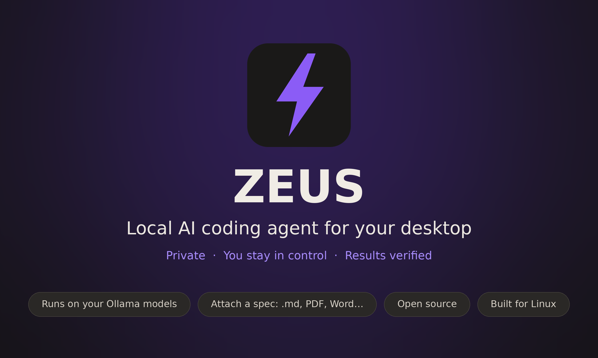
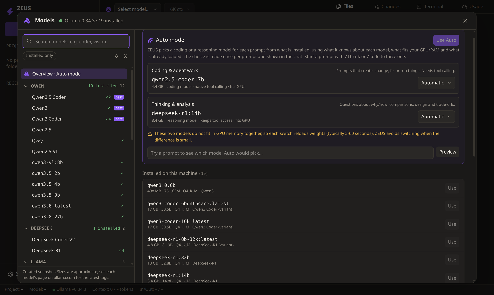
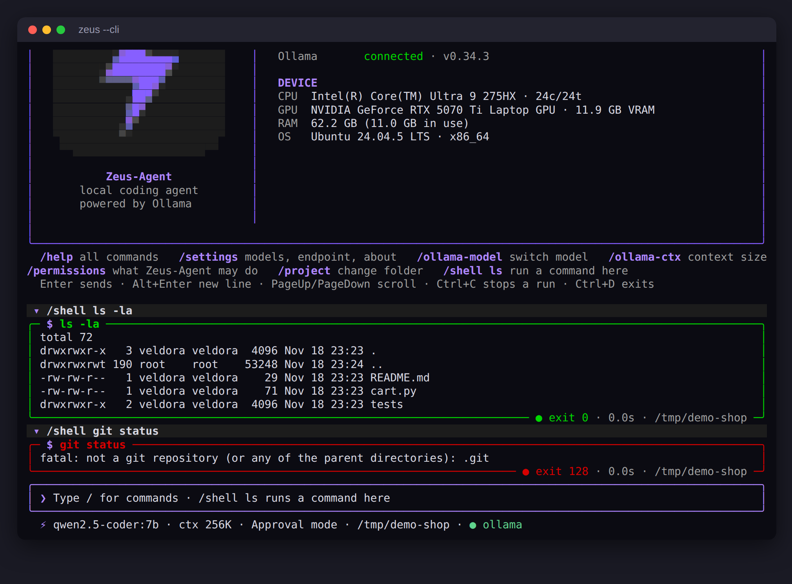
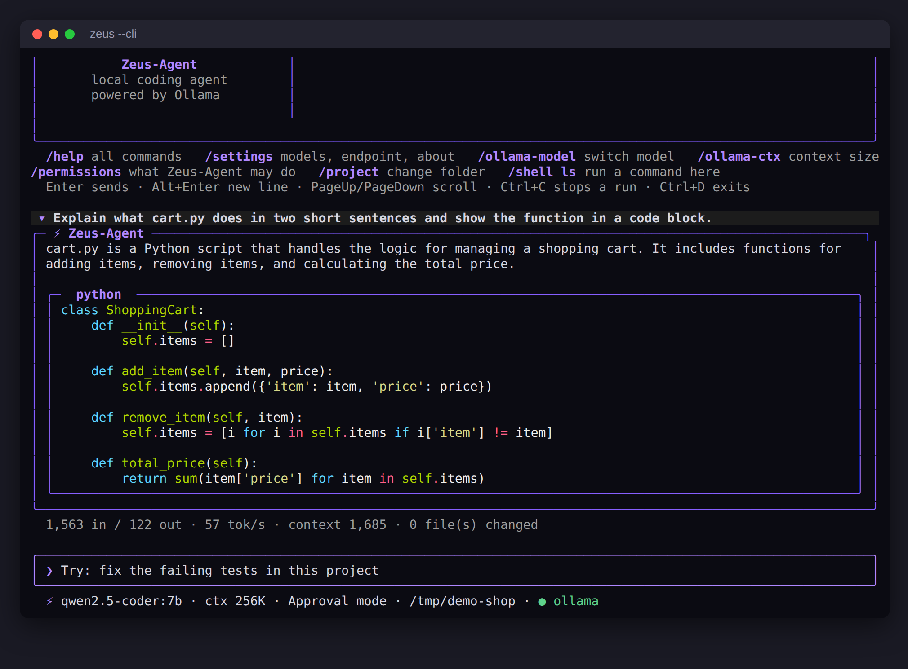

# ZEUS ⚡

<p align="center"></p>

<p align="center">
  <a href="https://zeus-agent.web.app/"><b>🌐 Website</b></a> ·
  <a href="https://github.com/Ayrus498/zeus/releases/latest"><b>⬇️ Download (.deb)</b></a> ·
  <a href="RELEASE_NOTES.md">Release notes</a> ·
  <a href="DEVELOPMENT_STATUS.md">Status</a> ·
  <a href="docs/ARCHITECTURE.md">Architecture</a> ·
  <a href="docs/COMMANDS.md">Terminal commands</a>
</p>

**A local, Claude-Code-style coding agent for your desktop, powered by [Ollama](https://ollama.com).**
Pick a project folder, pick a local model, describe what you want. ZEUS reads, creates, edits and runs code in
your folder, and every write or command passes through a permission engine you control. Nothing leaves your machine.

> **Status: Phase 1 (single agent).** Working on Ubuntu/Debian as an installable `.deb`. See
> [DEVELOPMENT_STATUS.md](DEVELOPMENT_STATUS.md) for exactly what is verified and what is not.

## Screenshots

<table>
  <tr>
    <td width="50%"><br><sub><b>Missions.</b> Attach a spec; ZEUS works in rounds until every acceptance criterion is verified, with evidence for each.</sub></td>
    <td width="50%"><br><sub><b>You stay in control.</b> Every write and command shows the diff or exact command inline, and waits for your decision.</sub></td>
  </tr>
  <tr>
    <td width="50%"><br><sub><b>Live usage.</b> GPU, VRAM and CPU while a local model generates.</sub></td>
    <td width="50%"><br><sub><b>Models window</b> (Settings → Models). Search and browse model families, download or unload models; Auto picks a coding or a reasoning model per prompt.</sub></td>
  </tr>
  <tr>
    <td colspan="2"><br><sub><b>Attach any document.</b> PDF, Word, PowerPoint, Excel and more are converted to Markdown locally (MarkItDown) and run as a mission.</sub></td>
  </tr>
</table>

### Terminal UI (`zeus -code`)

<table>
  <tr>
    <td colspan="2"><br><sub><b>Welcome screen.</b> The ZEUS icon as terminal pixels, with model, context, permissions, project, Ollama status and your CPU, GPU/VRAM, RAM and OS beside it. The input box stays pinned to the bottom.</sub></td>
  </tr>
  <tr>
    <td width="50%"><br><sub><b>/shell.</b> Every command is one box with its output, exit status and time; green on success, red on failure.</sub></td>
    <td width="50%"><br><sub><b>Agent runs.</b> Approve a command, see its output in a box, then read the answer.</sub></td>
  </tr>
  <tr>
    <td width="50%"><br><sub><b>Answer cards.</b> The reply is parsed as Markdown; code gets its own box.</sub></td>
    <td width="50%"><br><sub><b>/ollama-model.</b> Searchable list of installed models.</sub></td>
  </tr>
</table>

More screens and every command: [docs/COMMANDS.md](docs/COMMANDS.md).

*Screenshots are from real runs on a demo project (model: `qwen3.5:9b` for the mission, `qwen2.5-coder:7b` for the others). The terminal screenshots are the real `zeus -code` screen captured through a pseudo-terminal and drawn in a window frame.*

## Features

- **Native desktop app** (Tauri 2) with a Claude-Code-Desktop-inspired UI: projects sidebar, chat timeline, Monaco file/diff viewer, terminal panel.
- **Any local Ollama model**: models are discovered dynamically (nothing hard-coded); choose context size (8K / 16K / 32K / 64K / model max) with a memory warning.
- **Tool-using agent**: `list_files`, `read_file`, `search_files`, `create_file`, `edit_file`, `delete_file`, `run_command`, `git_status`, `git_diff`. Works with native tool calls and falls back to parsing JSON / `<function=...>` tool calls printed as text by weaker models.
- **Backend-enforced permissions**: read-only / approval / trusted / custom, inline approval cards in the conversation (diffs and the exact command, Approve Once / Approve for Session / Reject), path and symlink validation.
- **Attach documents (MarkItDown)**: besides `.md`, attach PDF, Word, PowerPoint, Excel, CSV, HTML, JSON, XML, EPUB, Jupyter notebooks, ZIP or text files. ZEUS converts them to Markdown with Microsoft's [MarkItDown](https://github.com/microsoft/markitdown) (locally, in an isolated process with no network) and uses the result like any attached `.md`.
- **Missions (attach a `.md` file)**: click the paperclip (or drop a Markdown file on the prompt box) and ZEUS reads it as the task, then works in rounds until the result is *verified*: the agent does the work, a strict review pass checks every acceptance criterion against evidence (files written, commands run, exit codes), and anything unmet goes back to the agent. It stops when everything is accepted, when you press Stop, when a round makes no progress, or at the round limit. See [Missions](#missions-attach-a-md-file).
- **Model-aware prompting**: requests are shaped per model from Ollama's own metadata (tool/thinking capability, the creators' recommended sampling parameters) plus family rules (e.g. DeepSeek-R1 gets instructions in the user turn, thinking is off for fast tool steps on hybrid Qwen3 models, a text tool protocol for models without native tool calling) and the context window is sized to the document.
- **Auto model mode**: choose "✨ Auto" in the model dropdown and ZEUS picks a coding or a reasoning model for each prompt from the models you have installed (using what it knows about each model, your GPU/RAM and what is already loaded). The pick is explained in the chat; pin your own choice per role in the Models tab, or start a prompt with `/think` or `/code` to force one.
- **Terminal UI (`zeus -code`)**: a Claude-Code-style coding agent right in your terminal. It opens in the folder you start it from, shows the thunder-bolt with your session and device information beside it, and takes prompts with a live slash-command menu: `/settings` (Models, Ollama endpoint, Current model, Installed models, About), `/ollama-model`, `/ollama-ctx`, `/permissions` (read only / approval / trusted), `/project <path>`, `/mission <file>`, `/new`, `/resume`, `/changes`, `/doctor` and more. File changes and commands are approved inline. It shares projects, conversations and permissions with the desktop app. See [Terminal UI](#terminal-ui-zeus--code).
- **Settings drop-up menu**: Models, Ollama endpoint, Current model, Installed models and About (version, founder, GitHub, platform, CPU, GPU/VRAM, RAM and swap, read from the real machine).
- **Models window (Settings → Models)**: a searchable window with collapsible families (Qwen, DeepSeek, Llama, Gemma, Mistral…) on the left and details on the right; a curated guide to ~30 well-known Ollama models (what each is best for, how well it suits the ZEUS agent, approximate sizes, whether it fits your GPU/RAM) with a detailed write-up and example prompts for each, the **latest details fetched live from ollama.com** (summary, README, available versions), **Download**, **Unload** and **Uninstall** buttons, live download progress, persisted download history and in-page error messages. If Ollama is missing, it shows an install/start guide with links.
- **Live Usage tab**: `ollama ps` (loaded models, GPU/CPU split, keep-alive), GPU utilization / VRAM (NVIDIA, AMD), Ollama and system CPU/RAM, with interactive hover charts, plus real token counts from Ollama.
- **Session memory in `.zeus/` folders**: every conversation (the context sent to Ollama) is mirrored to `<project>/.zeus/sessions/` and settings to `~/.zeus/settings.json`, and reloaded automatically when ZEUS or the project is opened (even after the internal database is lost). See [Where your data lives](#where-your-data-lives).
- **Persistent sessions** in SQLite, copy buttons on code blocks, streaming terminal with cancel and timeout.
- **Offline install**: the `.deb` bundles its Python dependencies; installing needs no network.

## Architecture

```
Tauri 2 shell ──► React + TS UI ──REST/WebSocket──► Python FastAPI backend ──► Ollama
 (window, backend      (Tailwind, Monaco,             ├ projects   ├ providers (Ollama)
  lifecycle)            zustand)                      ├ sessions   ├ agent loop
                                                      ├ tools      ├ permissions
                                                      ├ terminal   └ SQLite
                                                      ▼
                                              your project folder (edited in place)
```

The **backend owns every file operation and every authorization decision**. The UI only renders requests
and sends the user's answer; a rejected or unanswered request never executes. See [docs/ARCHITECTURE.md](docs/ARCHITECTURE.md).

## Run from source (development)

Requirements: Python 3.10+, Node 20+, [Ollama](https://ollama.com) running with at least one model (tool-capable models such as `qwen3-coder` work best), and `zenity` (native folder picker).

```bash
scripts/run-backend.sh                 # FastAPI on 127.0.0.1:8765 (creates backend/.venv on first run)
cd frontend && npm install && npm run dev   # UI on http://localhost:1420 (works in any browser)
```

Desktop shell (needs the Tauri system libraries, see below):

```bash
sudo apt install libwebkit2gtk-4.1-dev libgtk-3-dev libayatana-appindicator3-dev librsvg2-dev \
  libsoup-3.0-dev libjavascriptcoregtk-4.1-dev libssl-dev patchelf build-essential pkg-config
cd frontend && npm install && cd ..
# in another terminal: scripts/run-backend.sh   and   (cd frontend && npm run dev)
frontend/node_modules/.bin/tauri dev
```

## Build the .deb

Just want to use it? Download the ready-made package from the [website](https://zeus-agent.web.app/) or the [latest release](https://github.com/Ayrus498/zeus/releases/latest). To build it yourself:

```bash
packaging/build-deb.sh        # runs backend tests, builds the UI, runs `tauri build --bundles deb`
sudo apt install ./dist/zeus_0.2.0_amd64.deb
```

Building needs network once (Rust crates, npm packages, and the Python wheels, which `packaging/make-wheelhouse.sh`
downloads into `packaging/wheelhouse/`). The resulting package is self-contained: its `postinst` creates a virtualenv in
`/usr/lib/zeus/venv` and installs the bundled wheels **offline**. The wheels target the build machine's Python
(e.g. cp312, x86_64); on a different Python, `postinst` falls back to PyPI.
Ollama and models are not bundled. Install them separately.

**Run / uninstall**

```bash
zeus                       # or launch "zeus" from the application menu (it starts its own backend on 127.0.0.1:8765)
sudo apt remove zeus       # your data stays in ~/.local/share/zeus (delete it to remove sessions/history)
```

## Missions (attach a `.md` file)

Write what you want in Markdown and attach it (paperclip, or drag the file onto the prompt box; up to 200 KB). A good document has an
**Objective** and an **Acceptance criteria** checklist (checkboxes, or a section named *Acceptance criteria / Requirements / Definition of done /
Deliverables / Verification*) - see [docs/examples/mission-example.md](docs/examples/mission-example.md). Without criteria, ZEUS asks the model to extract
verifiable ones. You can add extra instructions in the prompt box and pick the maximum number of rounds.

What happens: the agent works with its normal tools -> **evidence** is collected (files written, commands run with exit codes, files named in the
criteria checked on disk) -> a reviewer pass judges each criterion from that evidence only; objective facts override it (a "tests pass" criterion needs the
latest test command to have exited 0; a named file must exist) -> unmet criteria and the failing output go back to the agent -> next round. The card in the chat
shows round, per-criterion status and evidence, the reviewer's feedback and how ZEUS prepared its requests for the model.

Notes: every write and command still goes through your permission mode (in *Approval* mode a long mission asks a lot - *Trusted* mode suits it);
a document is treated as your instructions, so attach only files you trust; small models may need several rounds or stall, which ZEUS reports instead of looping forever.

### Attaching other document types

The paperclip also accepts **.pdf, .docx, .pptx, .xlsx, .xls, .csv, .html, .json, .xml, .epub, .ipynb, .zip, .txt**. ZEUS converts the file to Markdown with
[MarkItDown](https://github.com/microsoft/markitdown) (the result is named `report.pdf.md`, shown with a preview so you can check it) and then it behaves exactly
like an attached `.md`: it becomes the mission document. Limits: 25 MB per file; converted text is cut at 200 KB (you are told when that happens).

What is deliberately **not** supported: images and audio (MarkItDown needs online services or an LLM for them), URLs, plugins, and scanned PDFs without a text layer
(run OCR first - you get a clear error). The conversion runs in a separate process with a hard timeout, CPU/memory limits and **network access blocked**; only the
converters ZEUS lists are loaded (no audio/YouTube/Bing/Azure converters), a corrupt file fails instead of being read as raw bytes, and nothing is written into your project.

Install note: the `.deb` bundles MarkItDown with its PDF/Word/PowerPoint/Excel extras so installing stays offline. That is about **100 MB of wheels** (the package is
~100 MB and ~500 MB on disk after install), mostly `onnxruntime`/`magika` (file-type detection), `numpy`/`pandas` (Excel) and `pillow`. To slim it down, edit the
`markitdown[...]` line in `backend/requirements.txt` (for example drop `xlsx,xls` to avoid pandas/numpy) before building. From source: `pip install -r backend/requirements.txt`.

## Where your data lives

| Location | Contents |
|---|---|
| `<project>/.zeus/sessions/<id>.json` | One file per conversation: messages, tool calls, model, context size, token counts |
| `<project>/.zeus/project.json`, `README.md`, `.gitignore` | Project info; `.gitignore` contains `*` so history is **never committed** by accident |
| `~/.zeus/settings.json` | Ollama endpoint, default model/context, the list of known projects |
| `~/.local/share/zeus/zeus.db` | Live SQLite store (fast queries); the `.zeus` files are the durable copy it is rebuilt from |

On startup ZEUS restores any projects, settings and sessions that the database lacks; adding or opening a project
restores its `.zeus/sessions`. Removing a project from ZEUS (or a lost database) never deletes `.zeus/`; deleting a session does remove its file.
Delete a project's `.zeus/` folder to forget its history. Safety: **permissions are never read from `.zeus/`** (a cloned repo cannot pre-grant
itself "trusted" mode), imported sessions are schema-validated and size-limited, and the agent's file tools cannot write to `.zeus/`.

## Permissions

| Mode | Behaviour |
|---|---|
| Read only | Agent can read; every write/command is denied (no prompt) |
| Approval | Reads allowed; everything else asks (default) |
| Trusted | File create/edit and ordinary commands allowed **inside the workspace**; delete, package install, git commit/push still ask |
| Custom | Per-operation allow / ask / deny |

Always enforced, in every mode: paths must resolve inside the project (`..` and symlink escapes rejected);
existing files are never overwritten by `create_file`; `sudo`, `su`, `rm -rf /`, pipe-to-shell and similar
commands are blocked outright. "Approve for Session" is scoped to the exact operation (same action + same
file/command), not to a whole category.

> Limitation: commands run as your user in a normal shell. ZEUS shows you the exact command and gates it, but it
> does not sandbox it — approve commands the way you would paste them into your own terminal.

## Tests

```bash
cd backend && .venv/bin/python -m pytest      # permissions, path safety, tools, runner, agent loop, API
cd frontend && npm test && npm run build      # unit tests + typecheck + production bundle
python3 scripts/e2e_demo.py --parent /tmp/zeus-demo --name zeus-notes   # REAL-model demo (needs running backend + Ollama)
```

## Repository layout

```
backend/      FastAPI backend (agent, tools, permissions, providers, sessions, terminal, metrics) + tests
frontend/     React + TypeScript + Tailwind UI (feature folders under src/features)
src-tauri/    Tauri 2 desktop shell (spawns/stops the backend) and app icons
packaging/    build-deb.sh, make-wheelhouse.sh, Debian postinst/prerm
scripts/      run-backend.sh (dev) and e2e_demo.py (real-model demo)
docs/         ARCHITECTURE.md, COMMANDS.md (zeus -code reference), screenshots
```

## Roadmap

Phase 2 (not started): multi-agent orchestration on top of the existing `AgentEngine`/`AgentSpec`. The data model and
event stream already carry an `agent` id. Memory, RAG and dashboards are out of scope for Phase 1.

## License

[MIT](LICENSE) © 2026 Ayrus498

## Terminal UI (`zeus -code`)

```bash
cd ~/my-project
zeus -code                  # opens in the current folder (also: zeus-code)
zeus -code ~/other-project  # or give a folder
zeus -code -m auto --permission-mode trusted
zeus -code -c               # continue the latest conversation of this folder
zeus -code -p "explain src/main.py"   # one prompt, print the answer, exit
```

The welcome screen shows the ZEUS app icon (drawn as terminal pixels, in true colour) on the left and, on the right, the model, context window, permissions, project folder, Ollama status and your CPU, GPU/VRAM, RAM and OS. Type to chat; type `/` for the command menu (arrow keys and Tab). The full command reference with screenshots is in [docs/COMMANDS.md](docs/COMMANDS.md).

<p align="center"></p>

| Command | What it does |
| --- | --- |
| `/settings` | Menu: **Models** (use, download by family with search, manage: use / unload / uninstall, Auto mode), **Ollama endpoint**, **Current model**, **Installed models**, context window, permissions, **About** |
| `/ollama-model` | Pick from your installed models, grouped by family; type to search (also `/ollama-model qwen3:8b`) |
| `/ollama-ctx` (alias `/ollama-ctxt`) | Context window: 8K to 128K, the model's maximum, or a custom size (also `/ollama-ctx 32k`) |
| `/permissions` | **Read only**, **Approval mode** or **Trusted workspace** |
| `/project [path]` | Change the project folder (default: where you started `zeus -code`); with no path, pick a recent one or type a path with Tab completion |
| `/mission <file>` | Run a Markdown, Word, PDF... document as a goal-driven mission (non-Markdown is converted with MarkItDown) |
| `/new`, `/resume` | New conversation, or continue an earlier one |
| `/changes [file]` | Files ZEUS changed, or the diff of one |
| `/usage`, `/status`, `/doctor`, `/about`, `/clear`, `/help`, `/exit` | Utilities |
| `/shell <command>` (or `!command`) | Run a shell command in the project folder and print its output in the message window, e.g. `/shell ls -la` or `/shell git status` (each command runs in its own shell, so `cd` does not stick: use `/project`; Ctrl+C stops it; 2-minute limit) |
| `/copy` | Copy the last answer or command output to the clipboard |
| `/fold`, `/unfold` | Fold every earlier prompt to one row / open them all (or click a `▾` / `▸` row to fold just that prompt and its output) |

<p align="center"> </p>

The screen is a chat layout: the message window on top (it scrolls; PageUp/PageDown or the mouse wheel) and the rounded input box pinned to the bottom row, with a status line under it. Everything ZEUS prints appears above the box as organised cards instead of raw text: the model's answer is parsed as Markdown into a titled **ZEUS** card (headings, lists, tables, and code blocks in their own box with the language on the edge; tool-call JSON the model printed is dropped), every command, whether you ran it with `/shell` or the agent did, becomes one box with the command on top, all of its output inside, and the exit status and time on the bottom edge (green on success, red on failure; `git diff` output is colour-highlighted), reads and file edits are one-line rows, and your own messages are shaded bubbles. While something runs you see a live preview above the box; selection lists and the `/` command menu open inside the screen without moving it. You can keep typing while ZEUS works; messages are queued. Because the app captures the mouse for scrolling, select text with Shift+drag or use `/copy`. Keys: Enter sends, Alt+Enter (or a trailing `\`) adds a line, Ctrl+C stops a running answer, Ctrl+D exits. While ZEUS works it shows "Thunderstorm is approaching…"; permission requests appear inline with the diff or command and the choices Yes / Yes for this session / No.
