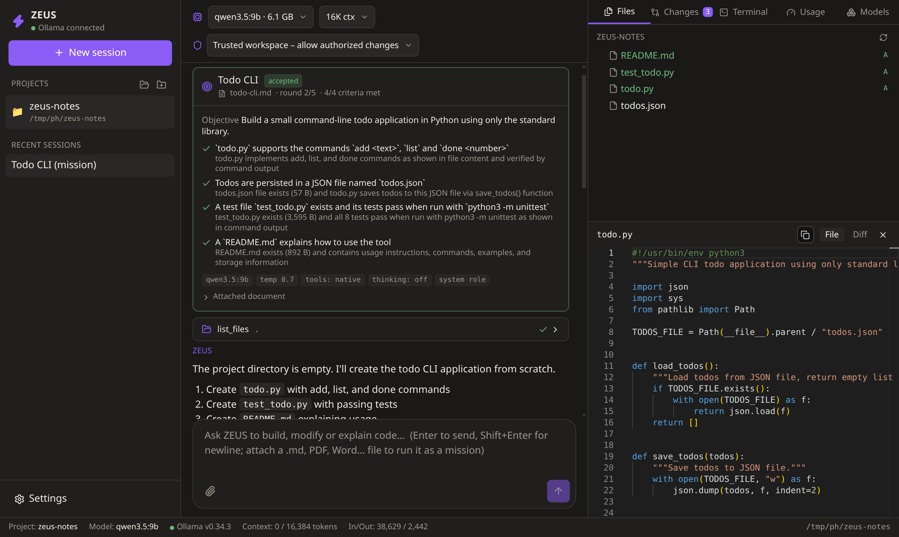
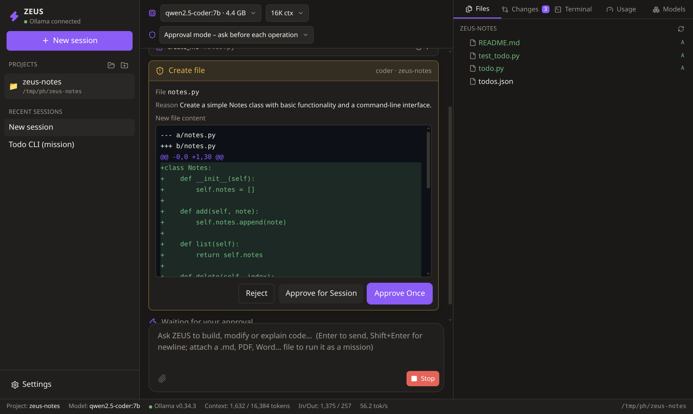
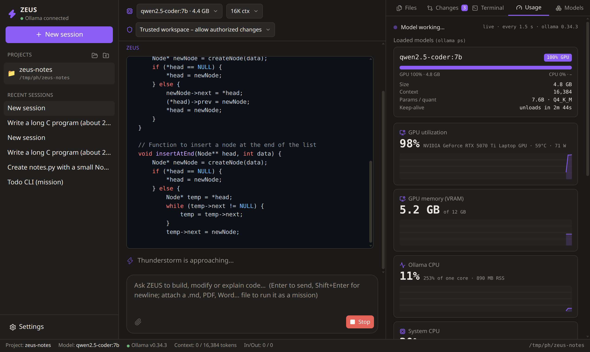
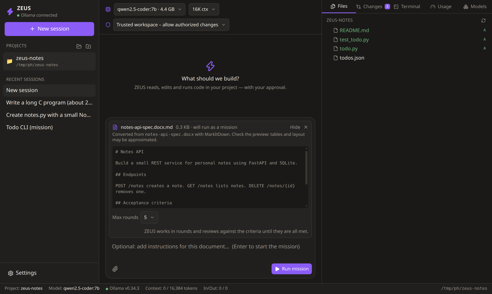
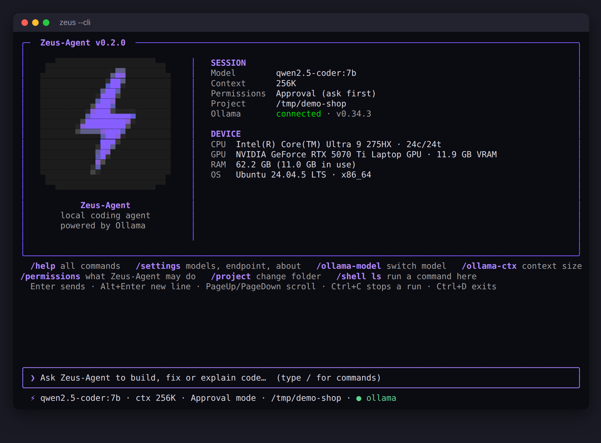
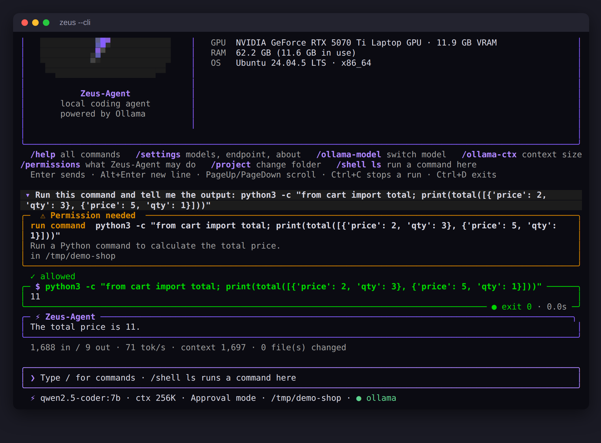
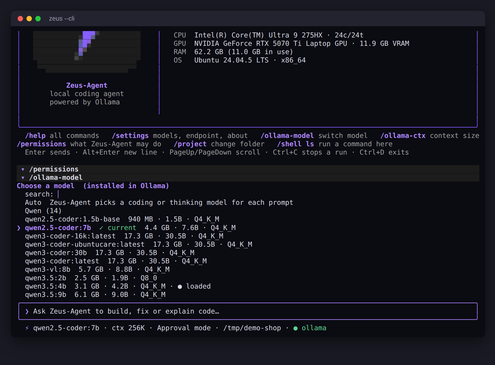
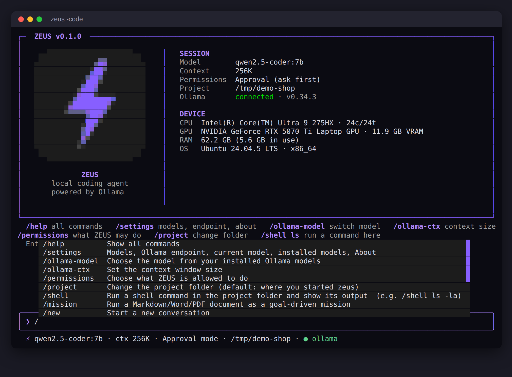
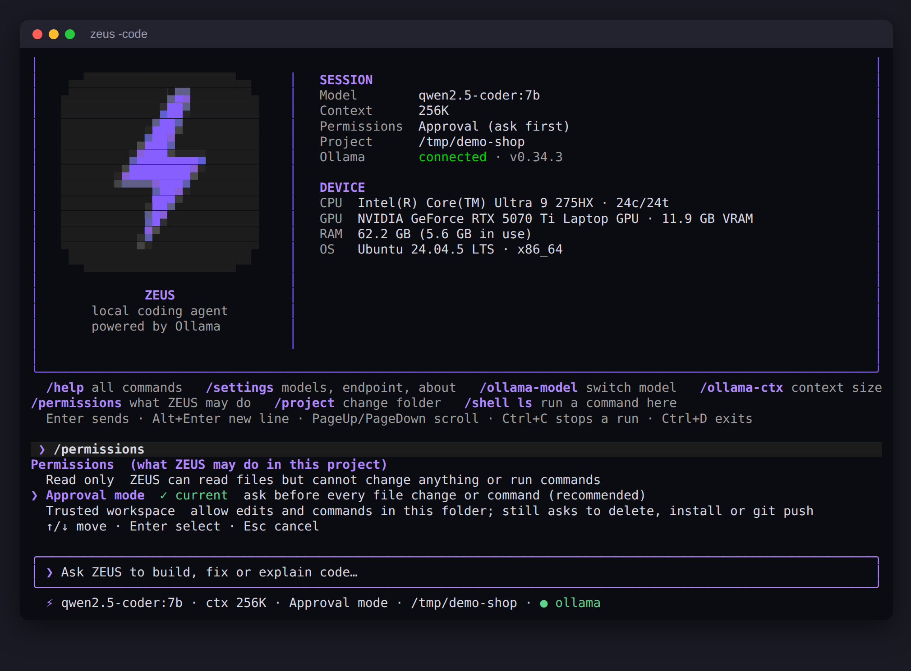

# Zeus-Agent ⚡

<p align="center"></p>

<p align="center">
  <a href="https://zeus-agent.web.app/"><b>🌐 Website</b></a> ·
  <a href="https://github.com/Ayrus498/zeus/releases/latest"><b>⬇️ Download (.deb)</b></a> ·
  <a href="RELEASE_NOTES.md">Release notes</a> ·
  <a href="DEVELOPMENT_STATUS.md">Status</a> ·
  <a href="docs/ARCHITECTURE.md">Architecture</a> ·
  <a href="docs/COMMANDS.md">Terminal commands</a> ·
  <a href="docs/agentic/README.md">Agentic development docs</a>
</p>

**A local, Claude-Code-style coding agent for your desktop, powered by [Ollama](https://ollama.com).**
Pick a project folder, pick a local model, describe what you want. Zeus-Agent reads, creates, edits and runs code in
your folder, and every write or command passes through a permission engine you control. Nothing leaves your machine.

> **Status: Phase 1 (single agent).** Working on Ubuntu/Debian as an installable `.deb`. See
> [DEVELOPMENT_STATUS.md](DEVELOPMENT_STATUS.md) for exactly what is verified and what is not.

## Screenshots

<table>
  <tr>
    <td width="50%"><br><sub><b>Missions.</b> Attach a spec; Zeus-Agent works in rounds until every acceptance criterion is verified, with evidence for each.</sub></td>
    <td width="50%"><br><sub><b>You stay in control.</b> Every write and command shows the diff or exact command inline, and waits for your decision.</sub></td>
  </tr>
  <tr>
    <td width="50%"><br><sub><b>Live usage.</b> GPU, VRAM and CPU while a local model generates.</sub></td>
    <td width="50%"><br><sub><b>Models window</b> (Settings → Models). Search and browse model families, download or unload models; Auto picks a coding or a reasoning model per prompt.</sub></td>
  </tr>
  <tr>
    <td colspan="2"><br><sub><b>Attach any document.</b> PDF, Word, PowerPoint, Excel and more are converted to Markdown locally (MarkItDown) and run as a mission.</sub></td>
  </tr>
</table>

### Terminal UI (`zeus --cli`)

<table>
  <tr>
    <td colspan="2"><br><sub><b>Welcome screen.</b> The Zeus-Agent icon as terminal pixels, with model, context, permissions, project, Ollama status and your CPU, GPU/VRAM, RAM and OS beside it. The input box stays pinned to the bottom.</sub></td>
  </tr>
  <tr>
    <td width="50%"><br><sub><b>/shell.</b> Every command is one box with its output, exit status and time; green on success, red on failure.</sub></td>
    <td width="50%"><br><sub><b>Agent runs.</b> Approve a command, see its output in a box, then read the answer.</sub></td>
  </tr>
  <tr>
    <td width="50%"><br><sub><b>Answer cards.</b> The reply is parsed as Markdown; code gets its own box.</sub></td>
    <td width="50%"><br><sub><b>/ollama-model.</b> Searchable list of installed models.</sub></td>
  </tr>
</table>

More screens and every command: [docs/COMMANDS.md](docs/COMMANDS.md).

*Screenshots are from real runs on a demo project (model: `qwen3.5:9b` for the mission, `qwen2.5-coder:7b` for the others). The terminal screenshots are the real `zeus --cli` screen captured through a pseudo-terminal and drawn in a window frame.*

## Features

- **Native desktop app** (Tauri 2) with a Claude-Code-Desktop-inspired UI: projects sidebar, chat timeline, Monaco file/diff viewer, terminal panel.
- **Any local Ollama model**: models are discovered dynamically (nothing hard-coded); choose context size (8K / 16K / 32K / 64K / model max) with a memory warning.
- **Tool-using agent**: `list_files`, `read_file`, `search_files`, `create_file`, `edit_file`, `delete_file`, `run_command`, `git_status`, `git_diff`. Works with native tool calls and falls back to parsing JSON / `<function=...>` tool calls printed as text by weaker models.
- **Backend-enforced permissions**: read-only / approval / trusted / custom, inline approval cards in the conversation (diffs and the exact command, Approve Once / Approve for Session / Reject), path and symlink validation.
- **Attach documents (MarkItDown)**: besides `.md`, attach PDF, Word, PowerPoint, Excel, CSV, HTML, JSON, XML, EPUB, Jupyter notebooks, ZIP or text files. Zeus-Agent converts them to Markdown with Microsoft's [MarkItDown](https://github.com/microsoft/markitdown) (locally, in an isolated process with no network) and uses the result like any attached `.md`.
- **Missions (attach a `.md` file)**: click the paperclip (or drop a Markdown file on the prompt box) and Zeus-Agent reads it as the task, then works in rounds until the result is *verified*: the agent does the work, a strict review pass checks every acceptance criterion against evidence (files written, commands run, exit codes), and anything unmet goes back to the agent. It stops when everything is accepted, when you press Stop, when a round makes no progress, or at the round limit. See [Missions](#missions-attach-a-md-file).
- **Model-aware prompting**: requests are shaped per model from Ollama's own metadata (tool/thinking capability, the creators' recommended sampling parameters) plus family rules (e.g. DeepSeek-R1 gets instructions in the user turn, thinking is off for fast tool steps on hybrid Qwen3 models, a text tool protocol for models without native tool calling) and the context window is sized to the document.
- **Auto model mode**: choose "✨ Auto" in the model dropdown and Zeus-Agent picks a coding or a reasoning model for each prompt from the models you have installed (using what it knows about each model, your GPU/RAM and what is already loaded). The pick is explained in the chat; pin your own choice per role in the Models tab, or start a prompt with `/think` or `/code` to force one.
- **Terminal UI (`zeus --cli`)**: a Claude-Code-style coding agent right in your terminal. It opens in the folder you start it from, shows the thunder-bolt with your session and device information beside it, and takes prompts with a live slash-command menu: `/settings` (Models, Ollama endpoint, Current model, Installed models, About), `/ollama-model`, `/ollama-ctx`, `/permissions` (read only / approval / trusted), `/project <path>`, `/mission <file>`, `/new`, `/resume`, `/changes`, `/doctor` and more. File changes and commands are approved inline. It shares projects, conversations and permissions with the desktop app. See [Terminal UI](#terminal-ui-zeus--code).
- **Settings drop-up menu**: Models, Ollama endpoint, Current model, Installed models and About (version, founder, GitHub, platform, CPU, GPU/VRAM, RAM and swap, read from the real machine).
- **Models window (Settings → Models)**: a searchable window with collapsible families (Qwen, DeepSeek, Llama, Gemma, Mistral…) on the left and details on the right; a curated guide to ~30 well-known Ollama models (what each is best for, how well it suits the Zeus-Agent agent, approximate sizes, whether it fits your GPU/RAM) with a detailed write-up and example prompts for each, the **latest details fetched live from ollama.com** (summary, README, available versions), **Download**, **Unload** and **Uninstall** buttons, live download progress, persisted download history and in-page error messages. If Ollama is missing, it shows an install/start guide with links. **The whole public Ollama library is listed too**: every other model on ollama.com/library (about 270 families, most popular first) appears under "Ollama library" with its description, capabilities, sizes and a one-click Download per version, and what you type in the search box is also searched on ollama.com, including community models (marked, with a warning that they are not reviewed). A new model such as `ornith` shows up without waiting for a Zeus-Agent update.
- **Live Usage tab**: `ollama ps` (loaded models, GPU/CPU split, keep-alive), GPU utilization / VRAM (NVIDIA, AMD), Ollama and system CPU/RAM, with interactive hover charts, plus real token counts from Ollama.
- **Session memory in `.zeus/` folders**: every conversation (the context sent to Ollama) is mirrored to `<project>/.zeus/sessions/` and settings to `~/.zeus/settings.json`, and reloaded automatically when Zeus-Agent or the project is opened (even after the internal database is lost). See [Where your data lives](#where-your-data-lives).
- **Persistent sessions** in SQLite, copy buttons on code blocks, streaming terminal with cancel and timeout.
- **Offline install**: the `.deb` bundles its Python dependencies; installing needs no network.

## Architecture

```
Tauri 2 shell ──► React + TS UI ──REST/WebSocket──► Python FastAPI backend ──► Ollama
 (window, backend      (Tailwind, Monaco,             ├ projects   ├ providers (Ollama)
  lifecycle)            zustand)                      ├ sessions   ├ agent loop
                                                      ├ tools      ├ permissions
                                                      ├ terminal   └ SQLite
                                                      ▼
                                              your project folder (edited in place)
```

The **backend owns every file operation and every authorization decision**. The UI only renders requests
and sends the user's answer; a rejected or unanswered request never executes. See [docs/ARCHITECTURE.md](docs/ARCHITECTURE.md).

## Run from source (development)

Requirements: Python 3.10+, Node 20+, [Ollama](https://ollama.com) running with at least one model (tool-capable models such as `qwen3-coder` work best), and `zenity` (native folder picker).

```bash
scripts/run-backend.sh                 # FastAPI on 127.0.0.1:8765 (creates backend/.venv on first run)
cd frontend && npm install && npm run dev   # UI on http://localhost:1420 (works in any browser)
```

Desktop shell (needs the Tauri system libraries, see below):

```bash
sudo apt install libwebkit2gtk-4.1-dev libgtk-3-dev libayatana-appindicator3-dev librsvg2-dev \
  libsoup-3.0-dev libjavascriptcoregtk-4.1-dev libssl-dev patchelf build-essential pkg-config
cd frontend && npm install && cd ..
# in another terminal: scripts/run-backend.sh   and   (cd frontend && npm run dev)
frontend/node_modules/.bin/tauri dev
```

## Build the .deb

Just want to use it? Download the ready-made package from the [website](https://zeus-agent.web.app/) or the [latest release](https://github.com/Ayrus498/zeus/releases/latest). To build it yourself:

```bash
packaging/build-deb.sh                      # builds the stored version (file VERSION): backend tests, end-to-end tests, UI, `tauri build --bundles deb`
packaging/build-deb.sh --tag subrelease     # x.y.z -> x.y.(z+1), then builds it
packaging/build-deb.sh --tag mainrelease    # x.y.z -> x.(y+1).0, then builds it
sudo apt install ./dist/zeus_$(cat VERSION)_amd64.deb
```

**Releases and versions.** `VERSION` is the only place a version is decided. `--tag` bumps it (a main release raises the middle number and resets the last, a sub release raises the last) and
writes it into every file that carries it: the app (`backend/app/core/config.py`), Cargo, Tauri and npm (and their lock files). From then on every plain build produces exactly that version, and
`dist/` holds only that one package with its `.sha256` and `RELEASE.json` (version, git tag name such as `v02_03`, checksum, commit). Packages of other versions, and an earlier build of the same version, are moved to `dist/archive/` (a rebuild never overwrites a package you may have installed or shared; `packaging/publish.py`) and are not
built again. A build refuses to start if any file disagrees with `VERSION`, and a failed `--tag` build restores the previous version. The script prints the tag to create (`git tag v02_03`); pushing
it is left to you. `packaging/version.py show|check|sync` inspects or repairs the version files, and `packaging/build_deb.sh` is the same script under the underscore name.

Building needs network once (Rust crates, npm packages, and the Python wheels, which `packaging/make-wheelhouse.sh`
downloads into `packaging/wheelhouse/`). The resulting package is self-contained: its `postinst` creates a virtualenv in
`/usr/lib/zeus/venv` and installs the bundled wheels **offline**. The wheels target the build machine's Python
(e.g. cp312, x86_64); on a different Python, `postinst` falls back to PyPI.
Ollama and models are not bundled. Install them separately.

**Run / uninstall**

```bash
zeus                       # opens the app and gives the terminal back (it runs in its own session, so closing the terminal does not close it)
zeus --foreground          # keep the app attached to this terminal (its output is otherwise appended to ~/.local/share/zeus/zeus.log)
zeus --cli                 # the terminal UI instead of the window
sudo apt remove zeus       # stops Zeus-Agent and removes what it kept in every user's home folder: settings, history, logs and the desktop window's data (a project's own .zeus folder and your project files are never touched). Models Zeus-Agent downloaded are kept, and the message says where
sudo apt purge zeus        # the same, and the downloaded models too
```

## Missions (attach a `.md` file)

Write what you want in Markdown and attach it (paperclip, or drag the file onto the prompt box; up to 200 KB). A good document has an
**Objective** and an **Acceptance criteria** checklist (checkboxes, or a section named *Acceptance criteria / Requirements / Definition of done /
Deliverables / Verification*) - see [docs/examples/mission-example.md](docs/examples/mission-example.md). Without criteria, Zeus-Agent asks the model to extract
verifiable ones. You can add extra instructions in the prompt box and pick the maximum number of rounds.

What happens: the agent works with its normal tools -> **evidence** is collected (files written, commands run with exit codes, files named in the
criteria checked on disk) -> a reviewer pass judges each criterion from that evidence only; objective facts override it (a "tests pass" criterion needs the
latest test command to have exited 0; a named file must exist) -> unmet criteria and the failing output go back to the agent -> next round. The card in the chat
shows round, per-criterion status and evidence, the reviewer's feedback and how Zeus-Agent prepared its requests for the model.

Notes: every write and command still goes through your permission mode (in *Approval* mode a long mission asks a lot - *Trusted* mode suits it);
a document is treated as your instructions, so attach only files you trust; small models may need several rounds or stall, which Zeus-Agent reports instead of looping forever.

### Attaching other document types

The paperclip also accepts **.pdf, .docx, .pptx, .xlsx, .xls, .csv, .html, .json, .xml, .epub, .ipynb, .zip, .txt**. Zeus-Agent converts the file to Markdown with
[MarkItDown](https://github.com/microsoft/markitdown) (the result is named `report.pdf.md`, shown with a preview so you can check it) and then it behaves exactly
like an attached `.md`: it becomes the mission document. Limits: 25 MB per file; converted text is cut at 200 KB (you are told when that happens).

What is deliberately **not** supported: images and audio (MarkItDown needs online services or an LLM for them), URLs, plugins, and scanned PDFs without a text layer
(run OCR first - you get a clear error). The conversion runs in a separate process with a hard timeout, CPU/memory limits and **network access blocked**; only the
converters Zeus-Agent lists are loaded (no audio/YouTube/Bing/Azure converters), a corrupt file fails instead of being read as raw bytes, and nothing is written into your project.

Install note: the `.deb` bundles MarkItDown with its PDF/Word/PowerPoint/Excel extras so installing stays offline. That is about **100 MB of wheels** (the package is
~100 MB and ~500 MB on disk after install), mostly `onnxruntime`/`magika` (file-type detection), `numpy`/`pandas` (Excel) and `pillow`. To slim it down, edit the
`markitdown[...]` line in `backend/requirements.txt` (for example drop `xlsx,xls` to avoid pandas/numpy) before building. From source: `pip install -r backend/requirements.txt`.

## Uninstalling cleanly

`sudo apt remove zeus` closes the app (and the llama-server it started) and then removes, **for every user who used it**, the folders `~/.zeus` and `~/.local/share/zeus` (database, settings, history, logs),
and the desktop window's own storage (`~/.local/share`, `~/.cache`, `~/.config` of `ai.zeus.desktop`). Nothing else is touched: not your project files and **not the `.zeus` folder inside your projects**
(their saved conversations and project memory belong to the project and come back when you open it again), not Ollama or its models, not models in your own folders. The cleanup runs as each user (never as root), deletes only files it knows, and never follows a symlink. The models Zeus-Agent downloaded are kept by `remove`
(they can be gigabytes) and removed by `sudo apt purge zeus`. To keep your data when uninstalling, create an empty file `~/.zeus/keep-data` first. Upgrades and `apt install --reinstall` never remove anything.
If Zeus-Agent was already removed by an older version, `cd backend && .venv/bin/python -m app.maintenance.cleanup --dry-run` (from a source checkout) lists what is left and, without `--dry-run`, removes it.

## Starting over: reset to a fresh installation

**Settings → Reset Zeus-Agent…** (or `/reset`, in the app and in the terminal) shows exactly what Zeus-Agent has saved and removes only what you tick, after you type `RESET`:
conversations, projects and settings (the database), the `.zeus` history and memory folder of each project, `~/.zeus/settings.json` and `state.json`, logs and terminal history, and
(not ticked by default, they can be large) the GGUF models Zeus-Agent downloaded itself. It never touches your own project files, Ollama and its models, models in folders you keep, or the
installed program (`sudo apt remove zeus`). It only deletes files it knows by name, never follows a symlink, and refuses requests that come from a web page. Afterwards the app starts as on a first run.

## Memory: project notes and long conversations

- **Project memory** (`<project>/.zeus/memory.md`) is a short Markdown file of lasting facts: the stack, conventions, the test command, your preferences. Every turn of
  every conversation in the project starts with it, so a new session is no longer a blank slate. Edit it in the desktop app (`/memory`, or Settings → Project memory),
  by hand, or say "remember that tests run with pytest -q": the agent calls its `remember` tool, which asks for your approval like any other change. It stays on your
  computer, is never committed, is size-limited and is given to the model as background notes that never override your request or the permission rules.
- **Rolling summary.** The full transcript is always kept. When what would be sent to the model reaches 75% of the context window, the older part is summarised by the
  same model (goal, decisions, files, state, next steps, preferences) and only that summary plus the newest messages are sent. Later summaries fold in the previous one.
  `/compact` does it now, `/summary` shows it, `/summary reset` undoes it, `/context` and the meter beside the prompt box show how full the window is.
- **Commands in the prompt box.** Type `/` in the desktop app: a menu lists every command (↑↓ choose, Tab completes, Enter runs). Commands either open the matching part of the
  interface (`/memory`, `/models`, `/best`, `/engine`, `/llamacpp`, `/changes`…) or show their result in the conversation (`/context`, `/compact`, `/help`…).

## Which model for which job (Models window → "Best for your hardware")

Zeus-Agent reads your GPU and RAM and ranks open models for **coding, agentic coding, agents, chat and reasoning, vision and documents** using
[Arena](https://arena.ai)'s blind human votes (CC BY 4.0), as compiled by [FreeLLMArena](https://freellmarena.com). Each model gets a verdict for *your* computer
(runs on the GPU, GPU plus RAM, CPU only, too large), an estimated speed, a table of every quantization (file size, where it runs, quality loss), the
matching `ollama pull` command and links to Hugging Face and GGUF files for llama.cpp. A family's page in the Models window also shows its Arena score and rank.
In the terminal: `/best`, `/best coding`, `/best agents all`. A snapshot ships with the app; **Refresh** fetches the newest rankings (one plain request to
freellmarena.com, nothing about you is sent). Scores say which answers people prefer, not that a model passes a test suite; speeds are estimates (about ±30%).
Not affiliated with Arena or FreeLLMArena.

## Engines: Ollama or llama.cpp

**Download, uninstall and Ollama's models.** The llama.cpp window's *Download* tab lists the most downloaded GGUF models on Hugging Face, searches as you type (only the typed text is sent), shows how each file would run on your computer and suggests one; *Models* shows where each model came from and lets you uninstall what Zeus-Agent downloaded or what sits in Hugging Face's / llama.cpp's cache (never your own folders). The models you already downloaded with **Ollama** appear there too, as `ollama/<name>`: llama.cpp reads Ollama's model file in place (no copy, no second download, Ollama untouched; remove them with `ollama rm`). In the terminal: `/llamacpp`.

llama.cpp: Zeus-Agent finds `llama-server` by itself (PATH, your home folder, /opt, /usr/local; real llama.cpp installs only, never Ollama's runner), prefers the build that can use your GPU, and the llama.cpp window (Engine & folders → Found on this computer, or `/llamacpp` in the terminal) lets you pick another or search again.

The **Engine** dropdown (before the model dropdown) switches between Ollama and llama.cpp. **Help me choose…** compares them and suggests one for your machine.
llama.cpp runs GGUF files through `llama-server`; **llama.cpp settings…** sets the `llama-server` path and model folders, tunes GPU layers, context, KV cache and
flash attention per model, downloads GGUF files from Hugging Face and shows the server log. Each conversation keeps its own engine and model. In the terminal use
`/engine`, `/llamacpp` and `zeus --cli --engine llamacpp`; `zeus --cli --continue` resumes the conversation you had in the desktop app, engine and model included.

## Where your data lives

| Location | Contents |
|---|---|
| `<project>/.zeus/sessions/<id>.json` | One file per conversation: messages, tool calls, model, context size, token counts |
| `<project>/.zeus/project.json`, `README.md`, `.gitignore` | Project info; `.gitignore` contains `*` so history is **never committed** by accident |
| `~/.zeus/settings.json` | Ollama endpoint, default engine/model/context, llama.cpp settings, the list of known projects |
| `~/.zeus/state.json` | Where you were: project, conversation, engine, model, context and permission mode, written by the desktop app and by `zeus --cli`. `zeus --cli --continue` resumes it |
| `~/.local/share/zeus/zeus.db` | Live SQLite store (fast queries); the `.zeus` files are the durable copy it is rebuilt from |

On startup Zeus-Agent restores any projects, settings and sessions that the database lacks; adding or opening a project
restores its `.zeus/sessions`. Removing a project from Zeus-Agent (or a lost database) never deletes `.zeus/`; deleting a session does remove its file.
Delete a project's `.zeus/` folder to forget its history. Safety: **permissions are never read from `.zeus/`** (a cloned repo cannot pre-grant
itself "trusted" mode), imported sessions are schema-validated and size-limited, and the agent's file tools cannot write to `.zeus/`.

## Permissions

| Mode | Behaviour |
|---|---|
| Read only | Agent can read; every write/command is denied (no prompt) |
| Approval | Reads allowed; everything else asks (default) |
| Trusted | File create/edit and ordinary commands allowed **inside the workspace**; delete, package install, git commit/push still ask |
| Custom | Per-operation allow / ask / deny |

Always enforced, in every mode: paths must resolve inside the project (`..` and symlink escapes rejected);
existing files are never overwritten by `create_file`; `sudo`, `su`, `rm -rf /`, pipe-to-shell and similar
commands are blocked outright. "Approve for Session" is scoped to the exact operation (same action + same
file/command), not to a whole category.

> Limitation: commands run as your user in a normal shell. Zeus-Agent shows you the exact command and gates it, but it
> does not sandbox it — approve commands the way you would paste them into your own terminal.

## Tests

```bash
cd backend && .venv/bin/python -m pytest      # permissions, path safety, tools, runner, agent loop, API
cd frontend && npm test && npm run build      # unit tests + typecheck + production bundle
python3 scripts/manual/real_model_demo.py --parent /tmp/zeus-demo --name zeus-notes   # REAL-model demo (needs running backend + Ollama)
```

## Repository layout

```
backend/      FastAPI backend and terminal app, organised by feature: core, system, modelconnectors, modelhub, toolchain, agents, memory, workspace, documents, maintenance, mcp, api, cli (+ tests that mirror them)
frontend/     React + TypeScript + Tailwind UI (feature folders under src/features)
src-tauri/    Tauri 2 desktop shell (spawns/stops the backend) and app icons
packaging/    build-deb.sh (build_deb.sh), version.py, make-wheelhouse.sh, Debian postinst/prerm
scripts/      e2e/ (end-to-end suite), manual/ (one-off real-model and browser checks), data/ (data updaters), run-backend.sh (dev)
docs/         ARCHITECTURE.md, STRUCTURE.md (the map and the layering rules), COMMANDS.md (zeus --cli reference), agentic/ (requirements, design, development, testing and agent orchestration), screenshots
```

## Roadmap

Phase 2 (not started): multi-agent orchestration on top of the existing `AgentEngine`/`AgentSpec`. The data model and
event stream already carry an `agent` id. Memory, RAG and dashboards are out of scope for Phase 1.

## License

[MIT](LICENSE) © 2026 Ayrus498

## Terminal UI (`zeus --cli`)

```bash
cd ~/my-project
zeus --cli                  # opens in the current folder (also: zeus-cli; plain `zeus` opens the desktop app)
zeus --cli ~/other-project  # or give a folder
zeus --cli -m auto --permission-mode trusted
zeus --cli -c               # continue the latest conversation of this folder
zeus --cli -p "explain src/main.py"   # one prompt, print the answer, exit
```

The welcome screen shows the Zeus-Agent app icon (drawn as terminal pixels, in true colour) on the left and, on the right, the model, context window, permissions, project folder, Ollama status and your CPU, GPU/VRAM, RAM and OS. Type to chat; type `/` for the command menu (arrow keys and Tab). The full command reference with screenshots is in [docs/COMMANDS.md](docs/COMMANDS.md).

<p align="center"></p>

| Command | What it does |
| --- | --- |
| `/settings` | Menu: **Models** (use, download by family with search, manage: use / unload / uninstall, Auto mode), **Ollama endpoint**, **Current model**, **Installed models**, context window, permissions, **About** |
| `/ollama-model` | Pick from your installed models, grouped by family; type to search (also `/ollama-model qwen3:8b`) |
| `/ollama-ctx` (alias `/ollama-ctxt`) | Context window: 8K to 128K, the model's maximum, or a custom size (also `/ollama-ctx 32k`) |
| `/permissions` | **Read only**, **Approval mode** or **Trusted workspace** |
| `/project [path]` | Change the project folder (default: where you started `zeus --cli`); with no path, pick a recent one or type a path with Tab completion |
| `/mission <file>` | Run a Markdown, Word, PDF... document as a goal-driven mission (non-Markdown is converted with MarkItDown) |
| `/new`, `/resume` | New conversation, or continue an earlier one |
| `/changes [file]` | Files Zeus-Agent changed, or the diff of one |
| `/usage`, `/status`, `/doctor`, `/about`, `/clear`, `/help`, `/exit` | Utilities |
| `/shell <command>` (or `!command`) | Run a shell command in the project folder and print its output in the message window, e.g. `/shell ls -la` or `/shell git status` (each command runs in its own shell, so `cd` does not stick: use `/project`; Ctrl+C stops it; 2-minute limit) |
| `/copy` | Copy the last answer or command output to the clipboard |
| `/fold`, `/unfold` | Fold every earlier prompt to one row / open them all (or click a `▾` / `▸` row to fold just that prompt and its output) |

<p align="center"> </p>

The screen is a chat layout: the message window on top (it scrolls; PageUp/PageDown or the mouse wheel) and the rounded input box pinned to the bottom row, with a status line under it. Everything Zeus-Agent prints appears above the box as organised cards instead of raw text: the model's answer is parsed as Markdown into a titled **Zeus-Agent** card (headings, lists, tables, and code blocks in their own box with the language on the edge; tool-call JSON the model printed is dropped), every command, whether you ran it with `/shell` or the agent did, becomes one box with the command on top, all of its output inside, and the exit status and time on the bottom edge (green on success, red on failure; `git diff` output is colour-highlighted), reads and file edits are one-line rows, and your own messages are shaded bubbles. While something runs you see a live preview above the box; selection lists and the `/` command menu open inside the screen without moving it. You can keep typing while Zeus-Agent works; messages are queued. Because the app captures the mouse for scrolling, select text with Shift+drag or use `/copy`. Keys: Enter sends, Alt+Enter (or a trailing `\`) adds a line, Ctrl+C stops a running answer, Ctrl+D exits. While Zeus-Agent works it shows "Thunderstorm is approaching…"; permission requests appear inline with the diff or command and the choices Yes / Yes for this session / No.
