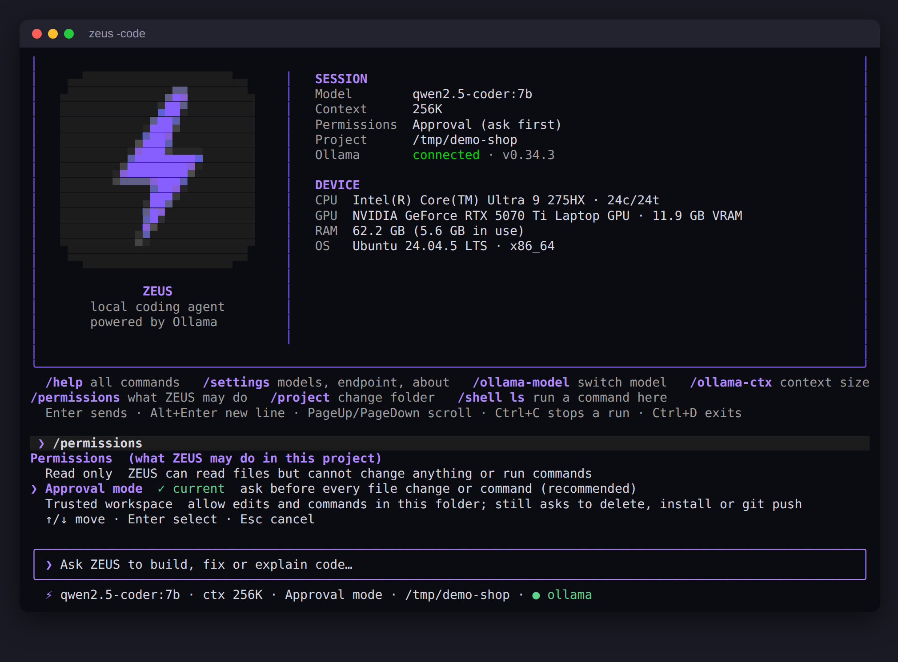
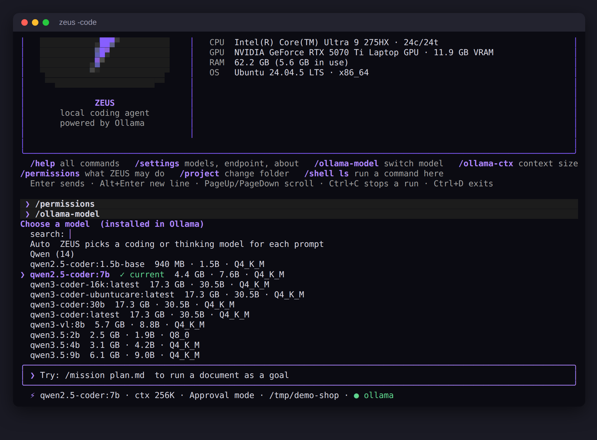
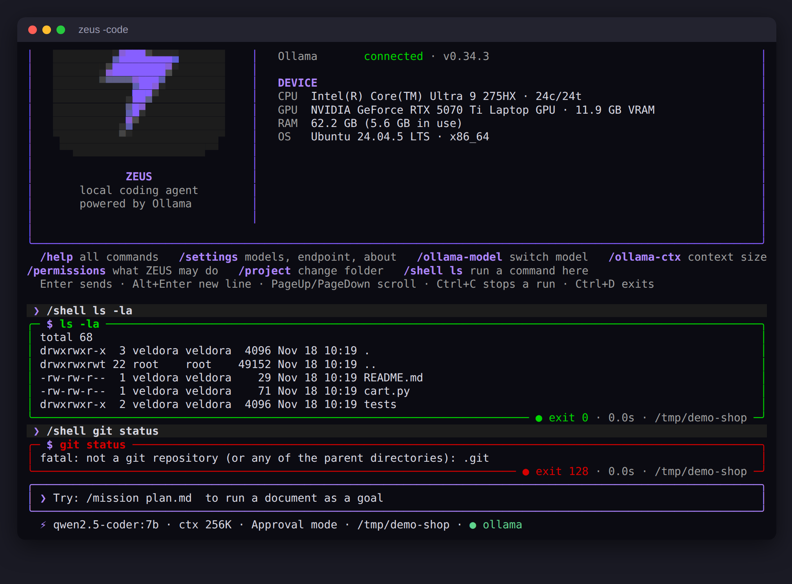
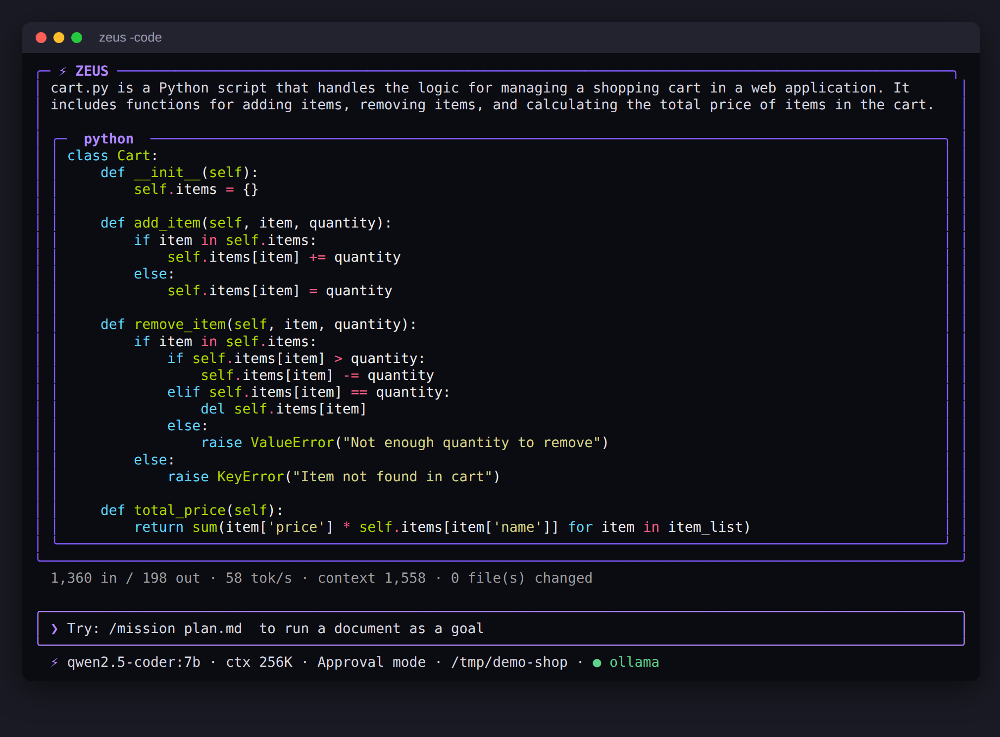
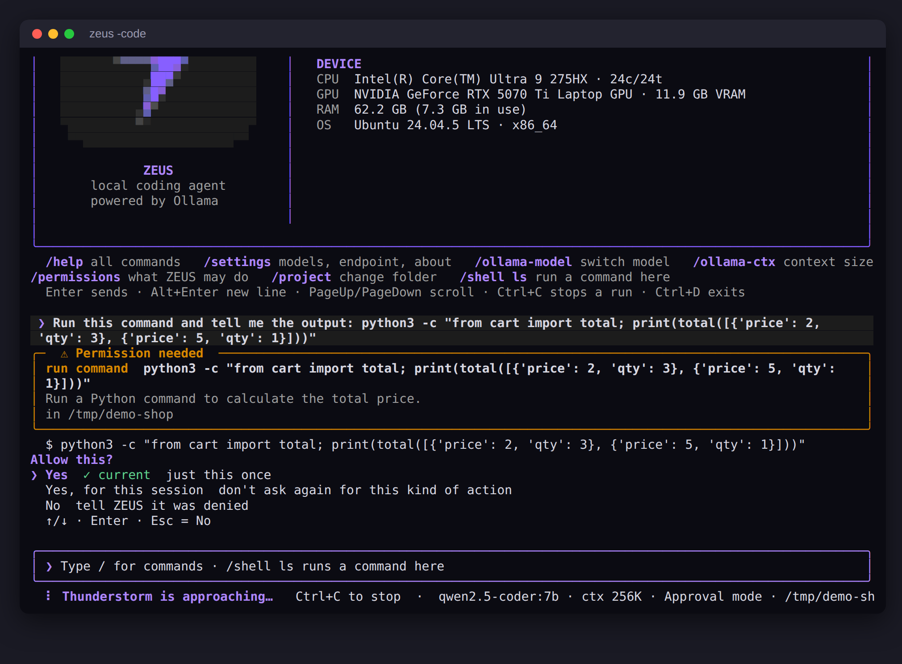
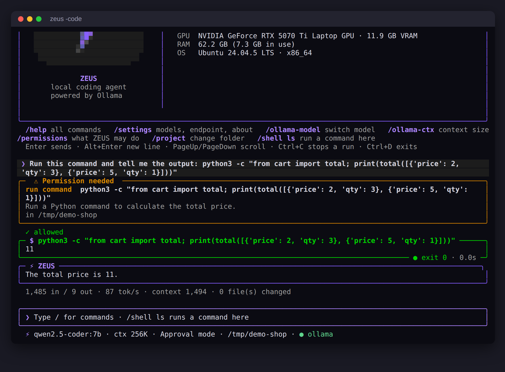
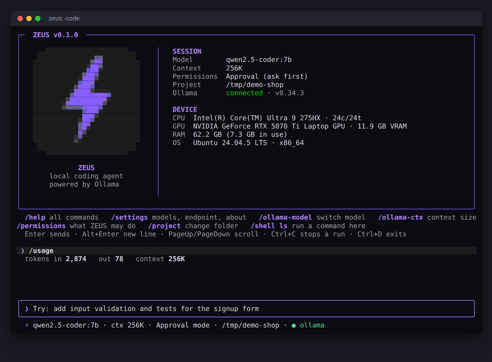

# `zeus -code`: terminal UI and command reference

`zeus -code` is ZEUS in your terminal: a chat-style coding agent that runs on your local Ollama models and
works in the folder you start it from. It talks to the same backend as the desktop app, so projects,
conversations and permissions are shared.

```bash
cd ~/my-project
zeus -code                       # open in the current folder (also: zeus-code)
zeus -code ~/other-project       # or give a folder
zeus -code -m auto --permission-mode trusted
zeus -code -c                    # continue the latest conversation of this folder
zeus -code -p "explain src/main.py"   # one prompt, print the answer, exit
```

| Option | Meaning |
| --- | --- |
| `path` | Project folder (default: the current directory) |
| `-m, --model` | Ollama model name, or `auto` |
| `--ctx` | Context window, e.g. `32768` or `32k` |
| `--permission-mode` | `read_only`, `approval` or `trusted` |
| `-c, --continue` | Continue the latest conversation of the folder |
| `-p, --print PROMPT` | Run one prompt non-interactively, print the answer, exit |
| `-V, --version` | Print the version |

## The welcome screen

The ZEUS thunder-bolt icon is drawn as terminal pixels (true colour). Beside it: the model, context window,
permission mode, project folder and Ollama status, then your CPU, GPU/VRAM, RAM and OS. The rounded input box
stays pinned to the bottom row; everything ZEUS prints appears above it.


## Slash commands

Type `/` to open the live command menu (arrow keys and Tab).


| Command | What it does |
| --- | --- |
| `/help` | List every command |
| `/settings` | Menu: **Models**, **Ollama endpoint**, **Current model**, **Installed models**, context window, permissions, **About** |
| `/ollama-model [name]` | Pick from your installed models, grouped by family; type to search |
| `/ollama-ctx [size]` (aliases `/ollama-ctxt`, `/ctx`) | Context window: 8K to 128K, the model's maximum, or a custom size |
| `/permissions` (alias `/perm`) | **Read only**, **Approval mode** or **Trusted workspace** |
| `/project [path]` (alias `/cd`) | Change the project folder; with no path, pick a recent one or type a path with Tab completion |
| `/shell <command>` (aliases `/sh`, `!command`) | Run a shell command in the project folder and print the output |
| `/mission <file>` | Run a Markdown, Word, PDF… document as a goal-driven mission |
| `/new`, `/resume` | New conversation, or continue an earlier one |
| `/changes [file]` (alias `/diff`) | Files ZEUS changed, or the diff of one |
| `/usage`, `/status`, `/doctor`, `/about` | Usage, session state, environment check, version and machine |
| `/copy` | Copy the last answer or command output to the clipboard |
| `/clear` | Clear the message window |
| `/exit` (aliases `/quit`, `/q`) | Leave |

### `/settings`, `/ollama-model` and `/permissions`

Selection lists open inside the screen, are searchable, and Esc closes them.






## `/shell`: run a command, see its output

Each command becomes one box: the command on the top edge, all of its output inside, and the exit status, time
and folder on the bottom edge. The edge is green when the command succeeded and red when it failed. While it runs
you see a live preview. Output is limited to the first 40 lines in the box (`/copy` copies everything), terminal
escape codes are stripped, and `git diff` is colour-highlighted. Each command runs in its own shell, so `cd` does
not stick (use `/project`). Ctrl+C stops it; there is a 2-minute limit.



## Answers

The model's reply is parsed as Markdown into a titled **ZEUS** card: headings, lists, tables, and code blocks in
their own box with the language on the edge. Tool-call JSON that a model prints as text is dropped. Reads and
file edits are one-line rows, and your own messages are shaded bubbles.



## Approvals and agent runs

In approval mode every file write and command stops and shows the diff or the exact command, with the choices
**Yes**, **Yes for this session** and **No**. Commands the agent runs appear in the same output boxes.





## Usage

`/usage` shows the loaded models and the GPU, VRAM, CPU and RAM use.



## Keys

| Key | Action |
| --- | --- |
| Enter | Send |
| Alt+Enter (or a trailing `\`) | New line |
| PageUp / PageDown, mouse wheel | Scroll the message window |
| Ctrl+C | Stop a running answer or command |
| Ctrl+D | Exit |
| Shift+drag | Select text (the app captures the mouse for scrolling); or use `/copy` |

You can keep typing while ZEUS works; messages are queued.
