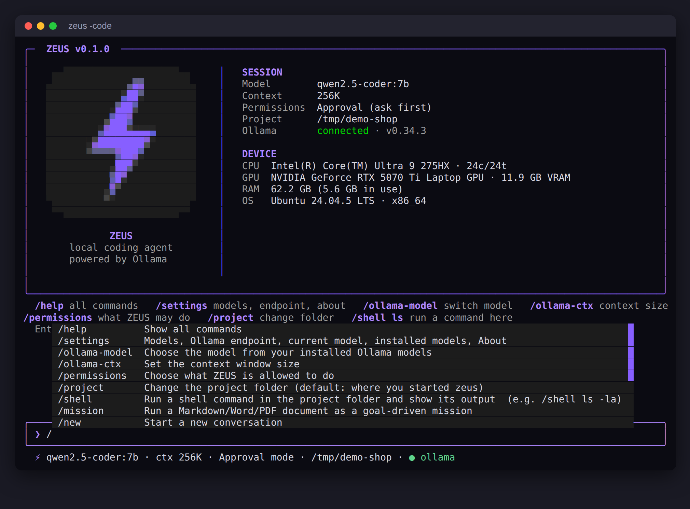
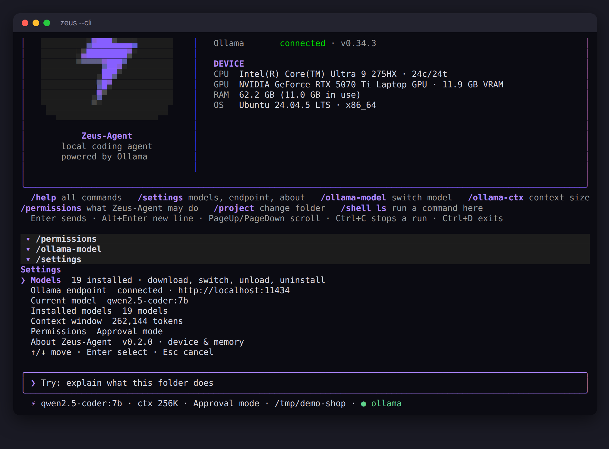
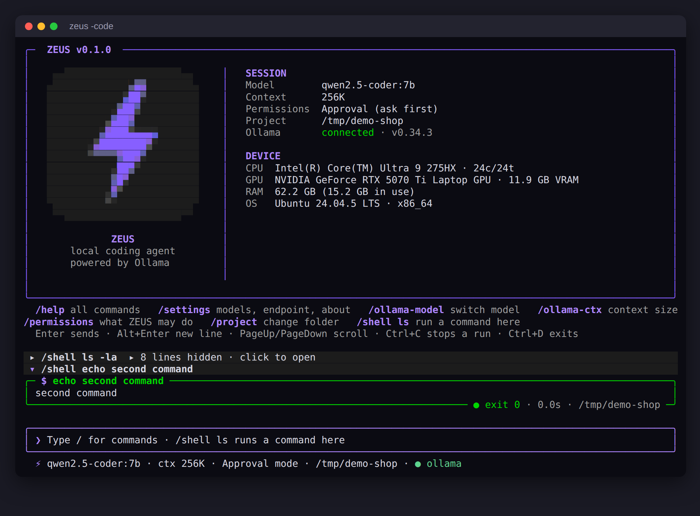

# `zeus --cli`: terminal UI and command reference

`zeus --cli` is Zeus-Agent in your terminal: a chat-style coding agent that runs on your local Ollama models and
works in the folder you start it from. It talks to the same backend as the desktop app, so projects,
conversations and permissions are shared.

```bash
cd ~/my-project
zeus                             # no option: opens the desktop app
zeus --cli                       # open the terminal UI in the current folder (also: zeus-cli)
zeus --cli ~/other-project       # or give a folder
zeus --cli -m auto --permission-mode trusted
zeus --cli -c                    # continue the latest conversation of this folder
zeus --cli -p "explain src/main.py"   # one prompt, print the answer, exit
```

| Option | Meaning |
| --- | --- |
| `--cli` | Start the terminal UI instead of the desktop app (`-cli` and `cli` work too; the old `-code` still works) |
| `path` | Project folder (default: the current directory) |
| `-m, --model` | Ollama model name, or `auto` |
| `--ctx` | Context window, e.g. `32768` or `32k` |
| `--permission-mode` | `read_only`, `approval` or `trusted` |
| `-c, --continue` | Continue the latest conversation of the folder |
| `-p, --print PROMPT` | Run one prompt non-interactively, print the answer, exit |
| `-V, --version` | Print the version |

## The welcome screen

The Zeus-Agent thunder-bolt icon is drawn as terminal pixels (true colour). Beside it: the model, context window,
permission mode, project folder and Ollama status, then your CPU, GPU/VRAM, RAM and OS. The rounded input box
stays pinned to the bottom row; everything Zeus-Agent prints appears above it.


## Commands in the desktop app

Typing `/` in the prompt box opens a command menu (↑↓ to choose, Tab to complete, Enter to run, Esc to close). Commands run even without a model and while Zeus-Agent is working.
Results appear as cards in the conversation (not saved with it); other commands open the matching window.

| Command | Result |
|---|---|
| `/context` (`/ctx`) | Card with the context meter, messages sent vs kept, summary and memory in use |
| `/compact` | Summarises older messages; card with before/after tokens and the summary; "Undo" button |
| `/summary [reset]` | Shows the summary, or forgets it |
| `/memory [show\|add <note>]` | Opens the project-memory editor; `show` prints it; `add` appends a note |
| `/remember <note>` | Appends a note to project memory |
| `/engine [ollama\|llamacpp\|help]` | Switches engine or opens the comparison |
| `/llamacpp`, `/models`, `/best` | Open the llama.cpp window, the Models window, the benchmarks view |
| `/permissions [mode]` | Shows or sets Read only / Approval / Trusted |
| `/files`, `/changes`, `/terminal`, `/usage` | Show that panel |
| `/reset` | Opens the Reset dialog: tick what to remove, type `RESET` |
| `/new`, `/clear`, `/stop`, `/settings`, `/help` | New conversation, clear the screen (history is kept), stop, About, list commands |
| `/think`, `/code` | Auto mode: force the reasoning or coding model for this prompt (sent as typed) |

The context chip beside the attach button shows the same meter (Σ = summary in use, mem = project memory in use); click it for `/context`.

## Starting and resuming

`zeus --cli --continue` (or `-c`) resumes the conversation you had last, in the desktop app or in the terminal: same project, engine, model and context (read from `~/.zeus/state.json`).
`zeus --cli --engine llamacpp` starts with llama.cpp.

## Slash commands

Type `/` to open the live command menu (arrow keys and Tab).



| Command | What it does |
| --- | --- |
| `/help` | List every command |
| `/context` | How full the context window is (meter), what is summarised, what project memory is in use |
| `/compact` | Summarise the older messages now to free context window |
| `/summary` | Show the rolling summary of this conversation; `/summary reset` forgets it |
| `/memory` | Show project memory; `/memory add <note>`, `/memory clear` |
| `/remember` | Save one note to project memory: `/remember Tests run with pytest -q` |
| `/reset` | Return to a fresh installation: shows what would be removed, asks you to type `RESET` (add `models` to include downloaded models) |
| `/best` | Which model is best for coding, agentic coding, agents, chat, vision or documents (Arena votes) and whether it runs on this computer. `/best coding`, `/best agents all` (include models that do not fit) |
| `/engine` | Choose Ollama or llama.cpp for this conversation, or get help choosing |
| `/llamacpp` | llama.cpp menu: `llama-server` path and the programs found, model folders, **Download a model** (search Hugging Face; each file shows how it runs here), **Uninstall a model**, stop the server. Models Ollama downloaded are listed too (shared, read only) |
| `/settings` | Menu: **Models**, **Ollama endpoint**, **Current model**, **Installed models**, context window, permissions, **About** |
| `/ollama-model [name]` | Pick from your installed models, grouped by family; type to search |
| `/ollama-ctx [size]` (aliases `/ollama-ctxt`, `/ctx`) | Context window: 8K to 128K, the model's maximum, or a custom size |
| `/permissions` (alias `/perm`) | **Read only**, **Approval mode** or **Trusted workspace** |
| `/project [path]` (alias `/cd`) | Change the project folder; with no path, pick a recent one or type a path with Tab completion |
| `/shell <command>` (aliases `/sh`, `!command`) | Run a shell command in the project folder and print the output |
| `/mission <file>` | Run a Markdown, Word, PDF… document as a goal-driven mission |
| `/new`, `/resume` | New conversation, or continue an earlier one |
| `/changes [file]` (alias `/diff`) | Files Zeus-Agent changed, or the diff of one |
| `/usage`, `/status`, `/doctor`, `/about` | Usage, session state, environment check, version and machine |
| `/copy` | Copy the last answer or command output to the clipboard |
| `/fold` (alias `/collapse`), `/unfold` (alias `/expand`) | Fold every earlier prompt to one row, or open them all again |
| `/clear` | Clear the message window |
| `/exit` (aliases `/quit`, `/q`) | Leave |

### `/settings`, `/ollama-model` and `/permissions`

Selection lists open inside the screen, are searchable, and Esc closes them.




## `/shell`: run a command, see its output

Each command becomes one box: the command on the top edge, all of its output inside, and the exit status, time
and folder on the bottom edge. The edge is green when the command succeeded and red when it failed. While it runs
you see a live preview. Output is limited to the first 40 lines in the box (`/copy` copies everything), terminal
escape codes are stripped, and `git diff` is colour-highlighted. Each command runs in its own shell, so `cd` does
not stick (use `/project`). Ctrl+C stops it; there is a 2-minute limit.


## Answers

The model's reply is parsed as Markdown into a titled **Zeus-Agent** card: headings, lists, tables, and code blocks in
their own box with the language on the edge. Tool-call JSON that a model prints as text is dropped. Reads and
file edits are one-line rows, and your own messages are shaded bubbles.


## Approvals and agent runs

In approval mode every file write and command stops and shows the diff or the exact command, with the choices
**Yes**, **Yes for this session** and **No**. Commands the agent runs appear in the same output boxes.


## Fold and unfold a prompt

Every prompt you send (and every `/shell` command) starts a block, and its first row carries an arrow. Click the
row to hide that prompt's output (the shell box, the model's answer, the approval); it collapses to a single
line, `▸ your prompt · N lines hidden · click to open`. Click it again to bring everything back (`▾`). `/fold`
folds all earlier prompts at once and `/unfold` opens them all. Folded blocks stay folded while new output
arrives, and `/clear` removes them. Mouse clicks need a terminal with mouse reporting (most have it).



## Usage

`/usage` shows the loaded models and the GPU, VRAM, CPU and RAM use.


## Keys

| Key | Action |
| --- | --- |
| Enter | Send |
| Alt+Enter (or a trailing `\`) | New line |
| PageUp / PageDown, mouse wheel | Scroll the message window |
| Ctrl+C | Stop a running answer or command |
| Ctrl+D | Exit |
| Click a `▾` / `▸` row | Fold or unfold that prompt and its output |
| Shift+drag | Select text (the app captures the mouse for scrolling); or use `/copy` |

You can keep typing while Zeus-Agent works; messages are queued.
