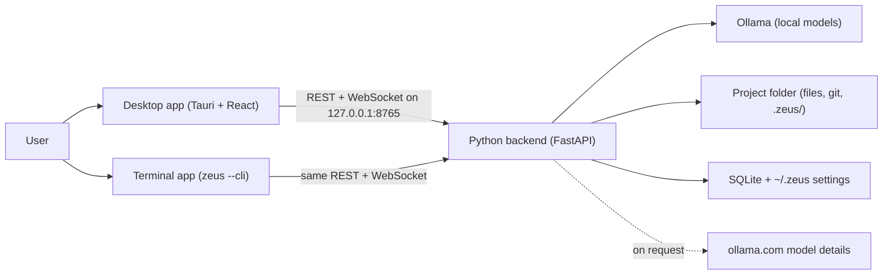
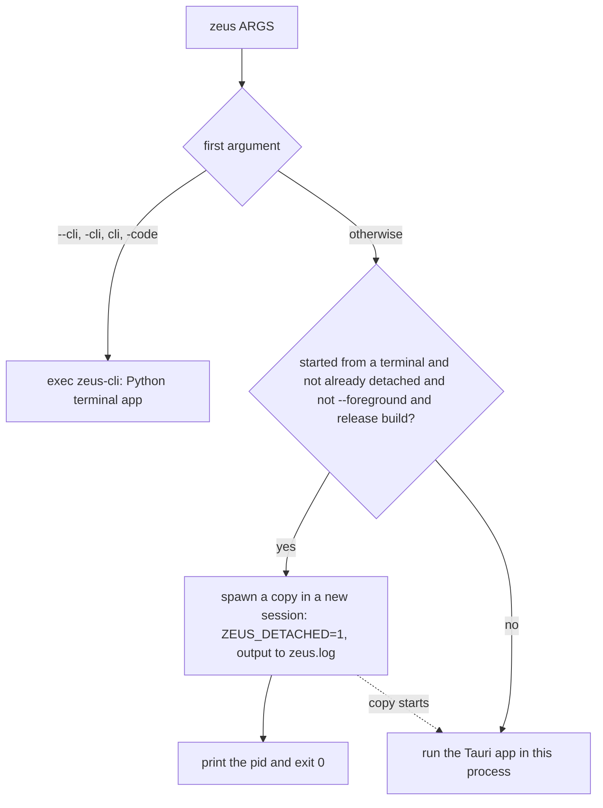

# Design

Owners: **A2 Architect** (structure, interfaces, decisions) and **A8 Security Reviewer** (§6). This document is the map;
the detailed notes for individual subsystems are in [../ARCHITECTURE.md](../ARCHITECTURE.md).

## 1. System context

Both front ends are clients of one backend. The backend owns every file operation, every command and every authorisation
decision; a front end only renders requests and sends the user's answer.

## 2. Components

| Component | Path | Responsibility | Owner agent |
|---|---|---|---|
| API | `backend/app/api` | REST and two WebSocket endpoints; wiring only | A3 |
| Agent | `backend/app/agent` | agent loop (`AgentEngine`), prompts, tool-call parsing, rescue of printed files, missions, per-model preferences, auto routing | A3 |
| Tools | `backend/app/tools` | tool schemas, argument validation, implementations; mutating tools call the permission engine first | A3 |
| Permissions | `backend/app/permissions` | modes, per-action policy, session grants, command classification | A3, A8 |
| Providers | `backend/app/providers` | Ollama client, model catalogue, live library details, downloads | A3 |
| Terminal runner | `backend/app/terminal` | controlled subprocess execution with streaming, timeout and cancellation | A3 |
| Projects and sessions | `backend/app/projects`, `sessions` | project registry, conversations, live `SessionRuntime` event bus | A3 |
| Persistence | `backend/app/database`, `persistence` | SQLite schema, `.zeus/` mirror and restore | A3 |
| Conversion | `backend/app/convert` | sandboxed document-to-Markdown conversion | A3 |
| About and metrics | `backend/app/about.py`, `metrics.py` | device information, GPU/CPU/RAM usage | A3 |
| Terminal app | `backend/app/cli` | full-screen client: layout, commands, cards, shell runner | A5 |
| Desktop UI | `frontend/src` | features: chat, projects, models, permissions, terminal, file explorer | A4 |
| Shell | `src-tauri` | window, backend lifecycle, `zeus` launcher dispatch and detaching | A6 |
| Packaging | `packaging` | `.deb` build, wheelhouse, launcher scripts, desktop entry | A6 |

## 3. Key flows

### 3.1 An agent turn
1. A client sends `{"type":"prompt"}` on `/ws/sessions/{id}`.
2. `AgentEngine` rebuilds history from SQLite, shapes the messages for the chosen model and streams Ollama's `/api/chat` with the tool schemas.
3. Tool calls arrive natively, or are parsed from text for models that print them.
4. `ToolEngine.execute` validates arguments, resolves paths inside the project and builds an operation (with a diff for edits).
5. `PermissionManager.authorize` decides allow, deny or ask. For ask, the runtime emits `permission_request` and the tool waits for `permission_response`.
6. After approval the path is re-resolved and re-checked, then the write or command runs; results are stored and fed back to the model.
7. The loop ends when the model replies without a tool call, the user stops it, or the step limit is reached.

### 3.2 Starting the apps

The terminal app starts its own backend when none is listening and stops it on exit. The desktop app does the same through the shell.

### 3.3 Scrolling while content streams (desktop UI)
A small controller (`frontend/src/lib/stickScroll.ts`) decides whether to follow new content. It follows only while the reader is at
the bottom. Before every automatic scroll it compares the element's real position with the last one it set, so a reader who has just
scrolled up is detected even before the browser delivers the scroll event, which is the race that used to pull the view back down.
Shrinking content (and the clamp that comes with it) is not taken for the reader scrolling up. The hook `useStickScroll` applies it to the
conversation, to command output and to streaming code blocks, and the conversation shows a "Jump to latest" button while the reader is away from the end.

## 4. Subsystem notes

### 4.1 Agent
* `AgentSpec(name, system_prompt, tools)` is the unit of an agent; `AgentEngine.run` takes a spec.
* The system prompt states workflow and rules, including that run, execute and launch mean executing a file and that reading a file is not running it.
* Small-model protection: text tool-call parsing, one retry for unparsable calls, saving a printed file through `create_file`, rejection of fabricated tool results, loop and oscillation guards.
* Missions reuse the same loop in rounds with a reviewer call, and hard checks that override the reviewer.

### 4.2 Permissions
Modes `read_only`, `approval` (default), `trusted` and `custom`. Policy is per action: read, create, edit, delete, run command, install, git commit and git push. Delete always asks. Session grants are keyed by action and target. Blocked commands (sudo, destructive patterns, pipe to shell) are never allowed.

### 4.3 Providers and models
A small interface (`chat_stream`, `show`, `list_models`) keeps other backends possible. Model capabilities and context length come from Ollama's `/api/show`; the catalogue adds purpose, examples and fit guidance; the full public library list and search come from ollama.com (`providers/library.py`, cached, offline copy kept), and live details are fetched and cached.

### 4.4 Desktop UI
React, TypeScript, Tailwind, zustand, Monaco. State in `stores/app.ts`; HTTP and WebSocket in `services/`. Scrolling behaviour is in §3.3. The webview has no native `confirm()`, so confirmations are in-app dialogs.

### 4.5 Persistence
SQLite for the working state; `<project>/.zeus/sessions/<uid>.json` and `~/.zeus/settings.json` as a human-readable durable copy restored at startup. Content under `.zeus/` is untrusted: permission modes are never read from it and the agent cannot write to it.

### 4.6 Terminal app
prompt_toolkit full-screen layout (scrolling message window, pinned input box, status line) with a rich console that renders into the window. Output is card based: Markdown answer card, a box per command with exit status, one-line rows for reads and edits, shaded user bubbles. Each prompt and its output is a foldable turn. Commands run by `/shell` use the same box as agent commands.

### 4.7 Shell and launcher
The Rust shell owns the window and the backend child process. `main.rs` dispatches `--cli` to the Python launcher (`zeus-cli`) and otherwise calls `maybe_detach`. The decision to detach is a pure function (`detach_wanted`) so it can be unit tested: detach only from a terminal, in a release build, when not already detached and when `--foreground`, `--no-detach` and `ZEUS_FOREGROUND` are absent. The detached copy runs `setsid`, has no controlling terminal and appends its output to `~/.local/share/zeus/zeus.log`. If spawning fails the program continues in the foreground.

## 5. Interfaces

### 5.1 REST (selection)
`/api/health`, `/api/settings`, `/api/about`, `/api/metrics`; `/api/ollama/*` (status, catalogue, library list, library search, library details for a family or a community model, pull, unload, delete); `/api/models`; `/api/projects` and `/api/projects/{id}/*` (open, tree, file, git, changes, permissions, files); `/api/sessions` and `/api/sessions/{id}/messages`; `/api/convert`; `/api/auto/*`.

### 5.2 WebSocket `/ws/sessions/{id}`
Client to server: `prompt`, `mission`, `stop`, `permission_response` (decisions `once`, `session`, `reject`).
Server to client: `run_start`, `model_selected`, `token`, `assistant_end`, `tool_call`, `tool_result`, `command_start`, `command_output`, `command_end`, `file_change`, `permission_request`, `usage`, `notice`, `error`, `mission_*`, `run_end`. Every event carries an `agent` id.
A second socket, `/ws/terminal/{pid}`, streams a user-typed terminal command.

### 5.3 Environment
`ZEUS_DATA_DIR`, `ZEUS_DB`, `ZEUS_OLLAMA_URL`, `ZEUS_HOST`, `ZEUS_PORT`, `ZEUS_MAX_STEPS`, `ZEUS_CMD_TIMEOUT`, `ZEUS_HOME` (isolates `~/.zeus` in tests), `ZEUS_RES_DIR` (installed resources), `ZEUS_CLI_BIN` (launcher override), `ZEUS_DETACHED` (set on the detached copy), `ZEUS_FOREGROUND` (stay attached), `VITE_ZEUS_API` (UI to backend address).

## 6. Security design

| Property | Mechanism | Verified by |
|---|---|---|
| Backend-enforced approval | no write, delete or command path bypasses `authorize` except a command the user types in the terminal panel, which is an explicit user action and is still denied in read-only mode and for blocked commands | `test_permissions.py`, `test_tools.py` |
| Path safety | paths resolve inside the project; absolute paths outside, `..` and symlink escapes are rejected; re-check after approval (time-of-check guard) | `test_tools.py` |
| No silent overwrite | `create_file` refuses an existing file; `edit_file` needs a unique exact match | `test_tools.py` |
| Untrusted persisted state | `.zeus/` content validated; permissions never read from it | `test_zeusdir.py` |
| Sandboxed conversion | worker subprocess with limits and sockets blocked after imports | `test_convert.py` |
| Local only | the backend binds to `127.0.0.1`; the desktop CSP allows only local connections | review |
| Detached launch | the copy gets no terminal and inherits no stdin; it adds no new network surface | launcher checks |

**A8 review triggers:** any change under `permissions/`, `tools/`, `api/`, `persistence/`, `convert/`, any new outbound network call, and any change to what the detached launcher passes to the child.

## 7. Packaging and release design
`packaging/build-deb.sh` runs the backend tests, builds the UI, builds with Tauri and copies the `.deb` to `dist/`. The package bundles Python wheels so installing needs no network, installs `/usr/bin/zeus` and `/usr/bin/zeus-cli` (and `zeus-code` as an alias), and a desktop entry whose display name is Zeus-Agent while the command stays `zeus`. The post-install script creates the virtual environment under `/usr/lib/zeus/venv`. Versions are kept in sync across the backend config, the Tauri config, `Cargo.toml` and `Cargo.lock` and the frontend package files.

## 8. The multi-agent runtime the product is designed for

Phase 1 runs one agent per session. The code is shaped so that several can share a session later:
* every message, event and permission request carries an `agent` id and `messages.agent` is persisted;
* `AgentSpec` plus a shared engine, one event bus (`SessionRuntime.emit`) and one permission manager let agents with different roles or models cooperate;
* the tool engine is stateless; state lives in `ToolContext`, so agents can run concurrently with separate contexts;
* providers are behind an interface.

The development model in [ORCHESTRATION.md](ORCHESTRATION.md) mirrors this: an orchestrator, specialised agents with owned paths and a shared permission policy (the owner's approval).

## 9. Decisions

| # | Decision | Why |
|---|---|---|
| D1 | One backend, two clients | one place for permissions and state; the terminal and desktop apps cannot drift |
| D2 | Backend enforces permissions | a UI bug cannot cause an unapproved write |
| D3 | Ollama only | local, private, one integration to test well |
| D4 | Text tool-call fallbacks | local models often print calls; failing silently was the top reported problem |
| D5 | SQLite plus a `.zeus/` mirror | fast working state and a recoverable, readable copy |
| D6 | Full-screen terminal app instead of scrolling output | the prompt can stay pinned and menus never move the screen; a non-fullscreen version drifted |
| D7 | Detach in a copy started with `setsid`, not a fork inside the GUI toolkit | forking after a GUI toolkit starts is unsafe; a fresh exec in a new session is simple and testable |
| D8 | Follow-the-end scrolling decided by position comparison, not by scroll events alone | scroll events arrive after content updates under fast streaming |
| D9 | Display name Zeus-Agent, command `zeus` | a clear product name without breaking existing commands, paths and variables |

## 10. Design change process
A change to an interface in §5, to the security properties in §6 or to a decision in §9 starts with a design note from A2 (what, why,
alternatives, risks, tests), reviewed by A8 when §6 is affected, and updates this file in the same work item.
