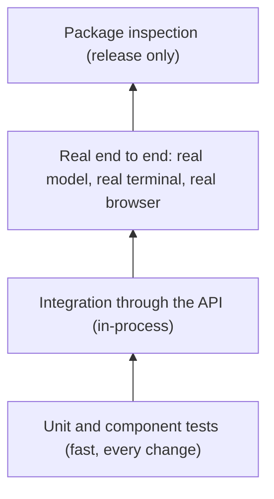

# Testing

Owners: **A7 QA Engineer** (suites, reports, defects) and **A9 Model Evaluator** (real-model behaviour). The orchestrator uses this
document to decide whether gates G3 to G5 in [ORCHESTRATION.md](ORCHESTRATION.md#3-gates) have passed.

## 1. Principles

1. **A test is evidence only if it can fail.** New behaviour comes with a test that fails without the change; a fix comes with a test that reproduces the defect first.
2. **Reproduce against the previous build.** A claim that a user-visible defect is fixed includes the same check run on the build before the fix, showing the defect.
3. **Real beats mocked for behaviour that depends on models, terminals or browsers.** Unit tests cover logic; real-model, pseudo-terminal and browser runs cover behaviour.
4. **Isolate.** Tests use throw-away `ZEUS_HOME` and `ZEUS_DATA_DIR` and never touch the owner's data. The pytest suite does this automatically (`backend/tests/conftest.py`).
5. **Own your processes.** Start servers with recorded pids and stop exactly those.
6. **Report what was not verified.**

## 2. Test layers



| Layer | What it proves | Where |
|---|---|---|
| Unit | pure logic: permissions, path rules, parsers, routers, formatters, the scroll controller, the detach decision | `backend/tests`, `frontend/src/__tests__`, Rust `mod tests` |
| Integration | REST and WebSocket behaviour with a real SQLite database and a scripted model | `test_api.py`, `test_agent.py`, `test_mission.py` |
| Terminal app | the real screen, driven through a pseudo-terminal and a screen emulator, with real Ollama models | `test_cli.py` and the pty method in §5 |
| Browser | the real UI in Chromium against a real backend and model | `scripts/manual/scroll_check.py`, `scripts/manual/models_library_check.py` and the method in §6 |
| End to end (build gate) | the real built UI in Chromium and the real terminal app in a pty, against a fake Ollama and the fake llama-server; includes the GUI-to-CLI hand-over through `state.json` | `scripts/e2e/` (run by `packaging/build-deb.sh`) |
| Launcher | the real release binary under a pseudo-terminal and a virtual display | method in §7 |
| Model behaviour | what real local models do with the agent's prompts and tools | `scripts/manual/real_model_demo.py`, §8 |
| Package | what is inside the `.deb`, and what its install/removal scripts do (run for real with stand-ins for getent/runuser and real processes: `test_maintainer_scripts.py`, `test_cleanup.py`) | `dpkg-deb` checks in §9 |

## 3. Suites and counts (as of 2026-11-25)

| Suite | Command | Count |
|---|---|---|
| Backend (pytest) | `cd backend && .venv/bin/python -m pytest -q` | **615** in 31 files |
| Frontend (vitest) | `cd frontend && npx vitest run` | **64** in 5 files |
| Shell (cargo) | `cd src-tauri && cargo test --lib` | **1** |
| Frontend types | `cd frontend && npx tsc --noEmit` | must report nothing |
| Frontend build | `cd frontend && npx vite build` | must succeed |

Backend tests live in `backend/tests/<package>/`, mirroring `backend/app` (`packaging/` holds the install-script and version tests); shared helpers stay at the top (`conftest.py`, `paths.py`, `gguf_util.py`, `fixtures/`). `test_architecture.py` checks the layering rules of [STRUCTURE.md](../STRUCTURE.md), that every router is mounted and that tests sit in the right folder; `modelconnectors/test_connector_contract.py` checks that every engine keeps the connector contract.

Backend files: `test_convert` 38, `test_cli` 34, `test_auto_router` 28, `test_mission` 24, `test_permissions` 23, `test_rescue` 20,
`test_models_library` 20, `test_tools` 18, `test_library` 10, `test_api` 16, `test_agent` 14, `test_zeusdir` 11, `test_modelprefs` 11, `test_model_details` 8,
`test_about` 5, `test_runner` 2. Frontend files: `modelGroups`, `timeline`, `stickScroll`.

The counts change as the code does; snapshot-style totals in tests are updated in the same change that alters the content.

## 4. What each area must cover

| Area | Minimum coverage |
|---|---|
| Permissions and tools | every mode against every action; traversal, absolute path, symlink escape; no overwrite; delete always asks; rejected or unanswered request never runs |
| Agent loop | native and text tool calls, unparsable-call retry, step limit, denied actions, printed-file rescue, fabricated tool results |
| Providers and models | status, listing, catalogue grouping, live-detail parsing against a saved fixture, download and delete rules |
| Persistence | restore after the database is deleted, schema validation of imported sessions, `.zeus/` is not writable by the agent |
| Terminal app | parsing and aliases, selection lists, event rendering, cards, live preview, scrolling, shell runs (stdout, stderr, cap, timeout, stop), copy, launcher with a project that has its own `app/` folder |
| Desktop UI logic | timeline reconstruction, model grouping, scroll following (see §6) |
| Shell | the detach decision for every input combination |

## 5. Terminal app checks (pseudo-terminal)

Method: start `packaging/zeus-cli --port <free port>` inside a pseudo-terminal, answer the terminal's cursor-position requests with the
real cursor row, feed the output to a screen emulator (`pyte`), send keys and assert on the emulated screen. Use real models
(`qwen2.5-coder:7b` for behaviour, `qwen3:0.6b` for speed) and a throw-away project folder.
Cases: banner, every slash command and selector, model switch, `/project`, streaming answer, approve and reject, Ctrl+C, `/shell` success and failure,
live preview, fold and unfold by real mouse click (SGR mouse sequences), prompt stays pinned.
Screenshots for the docs are rendered from the emulated screen to HTML and captured with headless Chromium (the snap build of Chromium cannot read `/tmp`; use a folder under `~/snap/chromium/common`).

## 6. Browser checks

**Scroll following (FR-16).**
* Unit: `stickScroll.test.ts` (8 tests) covers following at the bottom, the reader scrolling up before the scroll event is delivered, a long stream after the reader moved away, resuming at the bottom, partial scrolls, shrinking content, `jump()` and cleanup.
* Real browser: `scripts/manual/scroll_check.py` sends a prompt for a long answer, scrolls up with the mouse wheel while text arrives, samples the scroll position for 5 s, and checks that it held, that "Jump to latest" appeared and that it returns to the end.
* Reproduce on the previous build: serve the previous commit's `frontend` on another port (for example with `git archive HEAD frontend`) and run the same script; it must show the defect (position climbing back to the end, no button).

Result recorded on 2026-11-22 with `qwen3.5:4b`: previous build, position moved from 1185 to 1913 px by itself; new build, position stayed at 7 px for the full 5 s while the content grew from 2331 to 3312 px; the button appeared and returned to the end.

**Models window and the Ollama library (FR-03a).** `scripts/manual/models_library_check.py` opens Settings, Models, checks the library group, searches for a model that is only in the public library (`ornith`), opens it, checks the description, the `ollama pull` command and the version table, and presses Download with the request intercepted so nothing is pulled. It needs internet access to ollama.com.

How to run it safely: start a throw-away backend (`ZEUS_HOME=… ZEUS_DATA_DIR=… .venv/bin/python -m app` from `backend/`), start `npm run dev`, add one project through `POST /api/projects`, run the script, then stop those processes by pid.

## 7. Shell and launcher

| Check | How | Expected |
|---|---|---|
| Decision logic | `cargo test --lib` | detaches only from a terminal, in a release build, when not already detached and without `--foreground`, `--no-detach` or `ZEUS_FOREGROUND` |
| Detaches | release binary in a pseudo-terminal, `DISPLAY` pointing at a virtual display (`Xvfb`) | the prompt returns at once with the "started" line and exit status 0 |
| New session | `ps -o sid,tty` of the app | its own session, no controlling terminal |
| Survives the terminal | close the pseudo-terminal | the app is still running |
| Logging | `~/.local/share/zeus/zeus.log` (or `ZEUS_DATA_DIR`) | output of the detached copy is appended there |
| Foreground | `zeus --foreground` | the process stays attached |
| No terminal | launch with null stdin, stdout and stderr (as a desktop menu does) | runs in-process, no extra copy |
| Terminal app dispatch | `zeus --cli --version`, `-cli`, `cli`, `-code` | all print the version and exit |

Recorded on 2026-11-22: all of the above passed (returned in 0.04 s; own session; no terminal; alive after the terminal closed; `--foreground` and the no-terminal launch stayed in-process). The bare release binary has no bundled Python environment, so it logged a backend start-up error; that does not apply to the installed package.

## 8. Real-model behaviour (A9)

Run when a change affects prompts, tools, parsing or the agent loop.
* **Cases** are short, specific prompts with an observable result, for example "run the swap.out and print the output" (must execute `./swap.out`) and "show me what is inside swap.out" (must read it); "create a FastAPI notes app" with approvals auto-answered (`scripts/manual/real_model_demo.py`).
* **Record** the model, the prompt, what it did and the pass rate over at least 3 runs.
* **Models:** the owner's installed models; `qwen3-coder:30b` completes the notes application, `qwen2.5-coder:7b` needs the fallbacks and may not converge on large tasks (see `DEVELOPMENT_STATUS.md`).
* **Rule:** a prompt change needs a failing case before and a passing case after.

## 9. Package checks (release only)

* `dpkg-deb -f dist/zeus_<v>_amd64.deb Version Package` shows the version.
* `dpkg-deb -c` lists `/usr/bin/zeus`, `/usr/bin/zeus-cli`, `/usr/bin/zeus-code` and the desktop entry.
* Extract and grep the shipped code for the new behaviour (for example `fold_all` in `cli/ui/screen.py`, the run-means-run rule in `agents/prompts.py`).
* The desktop entry shows `Name=Zeus-Agent` and `Exec=zeus`.
* Record the SHA-256 in the release notes.
* Not verified in development: installing with `apt` (needs `sudo`) and launching the window against the installed package.

## 10. Defects and regressions

| Step | Owner | Content |
|---|---|---|
| Report | A7 | title, build, steps, expected, actual, evidence (output, screenshot or log) |
| Reproduce | A7 | a failing test or script |
| Fix | the owning engineer | change plus the now-passing test |
| Verify | A7 | the failing check passes; the full suites pass; the previous-build comparison is attached |
| Close | A0 | listed in the final report |

Flaky tests are reproduced, marked and reported; they are not rerun until green. A test that failed once and passed on rerun is mentioned in the test report.

## 11. Test report (A7 to A0)

```text
Build / commit:
Suites:   backend N passed, M skipped | frontend N | cargo N | tsc clean | vite build ok
New tests: <names> (each fails without the change: yes/no)
Real-model / browser / launcher evidence: <commands and results, previous-build comparison>
Defects found: <id, severity, status>
Not verified: <list>
```

## 12. Gate mapping

| Gate | Checks |
|---|---|
| G3 Build | `tsc --noEmit`, `vite build`, backend pytest, `vitest`, and for shell changes `cargo test --lib` and `cargo build --release` |
| G4 Review | review notes attached; security findings closed when triggered |
| G5 Test | everything in G3 on the final tree, plus the layer-specific evidence from §5 to §8 |
| Release | §9 package checks |

## 10. The end-to-end suite (`scripts/e2e/`)

`backend/.venv/bin/python scripts/e2e/run.py` runs 26 ordered cases (16 GUI, 9 CLI and a last, destructive GUI case that resets the stack) on one isolated stack: a fake Ollama (`fake_ollama.py`), the backend tests' fake `llama-server`, generated GGUF files, a temp project and the frontend built against the stack's port. GUI cases use Playwright/Chromium; CLI cases use a pseudo-terminal (`terminal.py`). The GUI cases create a conversation on llama.cpp and the CLI cases resume it with `--continue`, then a new Ollama conversation made in the terminal must appear as the saved state (`/api/state`).

| Option | Meaning |
|---|---|
| `--layer gui\|cli` | one side only (CLI resume cases skip without the GUI cases) |
| `--keep`, `--headed`, `--fail-fast`, `--out DIR` | keep logs, watch the browser, stop at the first failure, report folder (default `e2e-report/`) |
| `ZEUS_E2E=skip` | bypass the suite and print that it was not run (for machines without a browser) |

Reports: `report.md`, `report.json`, `junit.xml`, plus a screenshot, the terminal screen and the backend log for every failure. Exit code 0 passed, 1 a case failed, 2 the suite could not run. `packaging/build-deb.sh` runs it after the backend tests and stops the build on a non-zero exit (reports in `dist/e2e-report/`). The agent definition `.claude/agents/e2e-tester.md` runs it and triages failures. Setup: `pip install -r backend/requirements-dev.txt` and `playwright install chromium` (Playwright is pinned to the version whose Chromium is cached).
